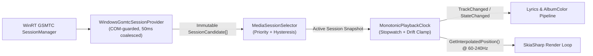
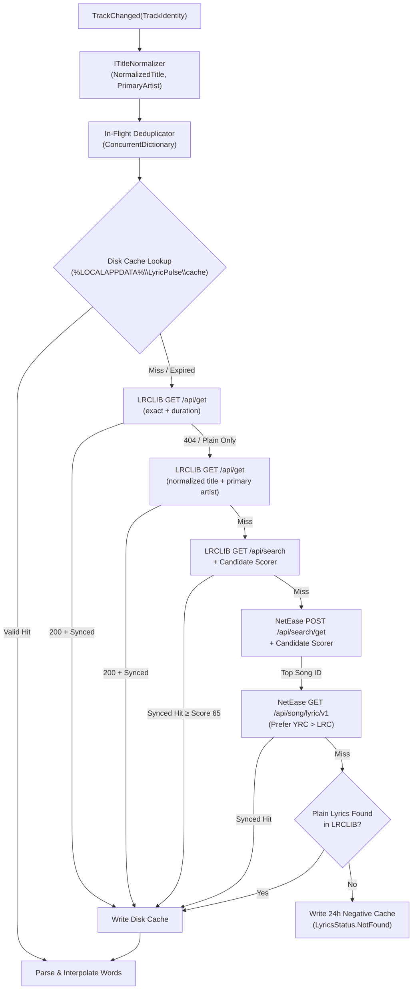
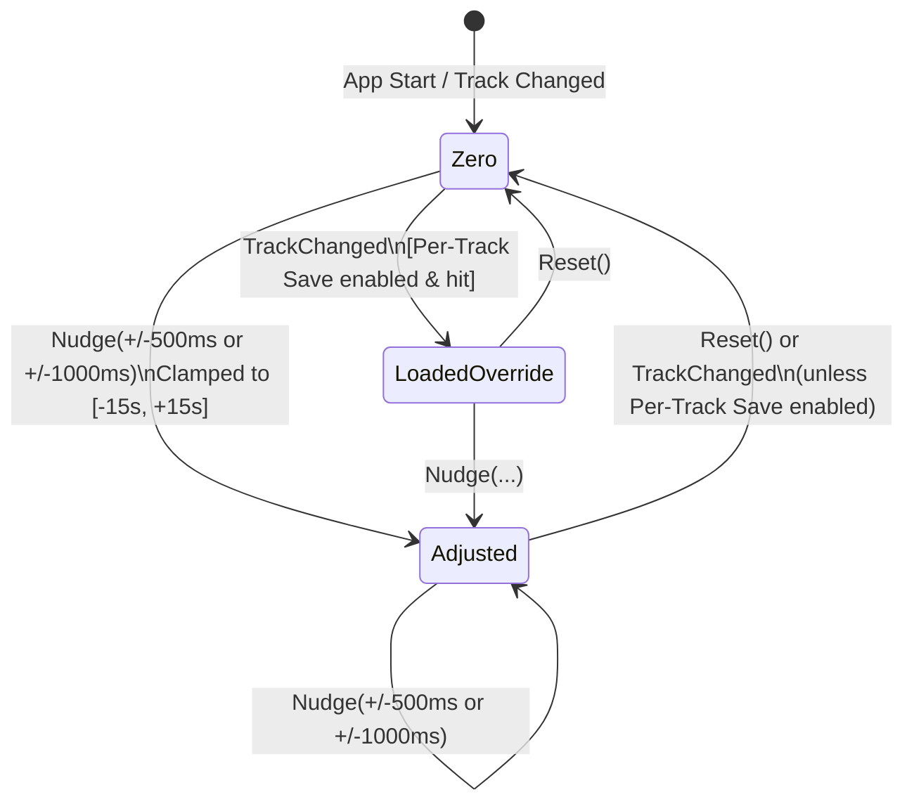

# LyricPulse Core Engine & Offline NLP Specification

> **Status:** Implementation-Ready Technical Specification  
> **Target Stack:** C# 14 / .NET 10 (`net10.0-windows10.0.19041.0`), CsWinRT, SkiaSharp, `System.Text.Json` Source Generation (NativeAOT-safe)  
> **Project Scope:** `LyricPulse.Core` and `LyricPulse.Tests`  
> **Engineering Standards:** Strict immutability (`record` / `ImmutableArray`), explicit boundary validation, zero UI-thread blocking, zero reflection/dynamic dispatch in runtime paths, ≥80% test coverage.

---

## 1. Runtime, TFM & NuGet Package Matrix

### 1.1 Target Framework & NativeAOT Configuration

All Windows-targeting projects (`LyricPulse.Core`, `LyricPulse.App`, `LyricPulse.Tests`) target `.NET 10` with the Windows 10 build 19041 WinRT contract:

```xml
<!-- Directory.Build.props -->
<Project>
  <PropertyGroup>
    <TargetFramework>net10.0-windows10.0.19041.0</TargetFramework>
    <SupportedOSPlatformVersion>10.0.19041.0</SupportedOSPlatformVersion>
    <LangVersion>latest</LangVersion>
    <Nullable>enable</Nullable>
    <ImplicitUsings>enable</ImplicitUsings>
    <TreatWarningsAsErrors>true</TreatWarningsAsErrors>
    <AnalysisLevel>latest-recommended</AnalysisLevel>

    <!-- NativeAOT & Trimming Safety -->
    <IsAotCompatible>true</IsAotCompatible>
    <EnableTrimAnalyzer>true</EnableTrimAnalyzer>
    <EnableAotAnalyzer>true</EnableAotAnalyzer>
    <CsWinRTAotOptimizerEnabled>true</CsWinRTAotOptimizerEnabled>
    <CsWinRTAotWarningLevel>2</CsWinRTAotWarningLevel>

    <!-- Keep full ICU globalization enabled for Unicode/CJK/Emoji normalization -->
    <InvariantGlobalization>false</InvariantGlobalization>
  </PropertyGroup>
</Project>
```

> [!IMPORTANT]
> **Critical TFM & WinRT Rules:**
> 1. Always use the `.0` revision suffix (`10.0.19041.0`, never `.1`) to avoid experimental CsWinRT MSBuild evaluation mismatches.
> 2. When `<TargetFramework>` is `net10.0-windows10.0.19041.0`, the .NET 10 SDK **implicitly resolves** the matching `Microsoft.Windows.SDK.NET.Ref` targeting pack (`10.0.19041.x`) for `Windows.Media.Control` (GSMTC). You do **not** add a manual `PackageReference` to `Microsoft.Windows.SDK.NET.Ref` unless pinning a specific patch via `<WindowsSdkPackageVersion>`.
> 3. Explicitly referencing `Microsoft.Windows.CsWinRT` `2.3.1` with `<CsWinRTAotOptimizerEnabled>true</CsWinRTAotOptimizerEnabled>` ensures static WinRT ABI marshalling and vtable generation so `GlobalSystemMediaTransportControlsSessionManager.RequestAsync()` survives NativeAOT trimming without `MissingMetadataException`.
> 4. Keep `<InvariantGlobalization>false</InvariantGlobalization>` because track normalization and lyric word segmentation rely on ICU Unicode categories, NFKC normalization, and grapheme clusters (`StringInfo` / `Rune`).

### 1.2 Central Package Management (`Directory.Packages.props`)

Use `<ManagePackageVersionsCentrally>true</ManagePackageVersionsCentrally>` so `LyricPulse.Core`, `LyricPulse.Rendering`, `LyricPulse.UI`, and `LyricPulse.Tests` share identical native binary versions.

| Package ID | Version | License | Project(s) | Purpose |
|---|---:|---|---|---|
| `Microsoft.Windows.CsWinRT` | `2.3.1` | MIT | `Core`, `App` | Static AOT-safe C#/WinRT projection generator for GSMTC |
| `SkiaSharp` | `3.119.0` *(or `2.88.9` — see ABI note)* | MIT | `Core`, `Rendering` | Album art decoding (`SKCodec`/`SKBitmap`) & canvas rendering |
| `SkiaSharp.NativeAssets.Win32` | `3.119.4` *(matches `SkiaSharp` major)* | MIT | `Core`, `App`, `Tests` | Native Windows `libSkiaSharp.dll` for album color extraction & headless tests |
| `System.Numerics.Tensors` | `10.0.0` | MIT | `Core` | `TensorPrimitives.Dot` hardware-accelerated SIMD (AVX2/AVX-512/SSE) |
| `System.Threading.RateLimiting` | `10.0.0` | MIT | `Core` | `TokenBucketRateLimiter` per lyrics provider (zero external resilience bloat) |
| `Microsoft.Extensions.DependencyInjection.Abstractions` | `10.0.0` | MIT | `Core` | Clean DI registration extensions |
| `Microsoft.Extensions.Http` | `10.0.0` | MIT | `Core` | `IHttpClientFactory` socket pooling & DNS refresh |
| `Microsoft.Extensions.Logging.Abstractions` | `10.0.0` | MIT | `Core` | Source-generated `[LoggerMessage]` structured logging |
| `Microsoft.NET.Test.Sdk` | `18.12.0` | MIT | `Tests` | VSTest host integration |
| `xunit.v3` | `4.0.3` | Apache-2.0 | `Tests` | Modern .NET 10 unit/integration test framework |
| `xunit.runner.visualstudio` | `4.0.1` | Apache-2.0 | `Tests` | `dotnet test` and IDE discovery adapter |
| `AwesomeAssertions` | `9.6.0` | Apache-2.0 | `Tests` | Open-source drop-in assertion library (replaces commercial FluentAssertions v8+) |
| `NSubstitute` | `6.2.0` | BSD-3-Clause | `Tests` | Interface mocking for GSMTC, HTTP, and clock abstractions |
| `coverlet.collector` | `10.1.1` | MIT | `Tests` | Cobertura / OpenCover branch & line coverage gate (≥80%) |

> [!WARNING]
> **SkiaSharp ↔ Avalonia ABI Lockstep Rule:**
> - **Avalonia 12.x (`12.2.0`)** natively targets **SkiaSharp `3.119.x`** (recommended for greenfield `.NET 10` projects in 2026).
> - **Avalonia 11.3.x** natively defaults to **SkiaSharp `2.88.9`** (though it supports explicit `3.119.0` overrides in `Directory.Packages.props`).
> - `LyricPulse.Core` MUST NEVER specify an independent `SkiaSharp` version; it inherits the exact major/minor version chosen by `LyricPulse.UI` in `Directory.Packages.props` to prevent `Incompatible native libSkiaSharp library` crashes at runtime.
> - **API Note:** In SkiaSharp `3.x`, `SKBitmap.Resize(SKImageInfo, SKFilterQuality)` is obsolete/removed in favor of `SKBitmap.Resize(SKImageInfo, SKSamplingOptions)`. Our album color extractor targets `SKSamplingOptions(SKFilterMode.Linear, SKMipmapMode.None)` on `3.x`.

> [!NOTE]
> **Licensing Hygiene on Assertions:** FluentAssertions `8.x+` transitioned to a commercial-restricted Xceed license. Because LyricPulse is 100% free and open-source, use **`AwesomeAssertions 9.6.0`** (Apache-2.0 community fork with identical API semantics) or pin `FluentAssertions 7.2.0` (last Apache-2.0 release).

---

## 2. Windows GSMTC Media Session Engine

### 2.1 Architecture Overview

Wrap Windows Runtime GSMTC types completely behind a clean, testable abstraction (`IMediaSessionProvider`) so **zero WinRT types leak** into domain logic, rendering, or unit tests. Split session tracking into two collaborating components:

1. **`WindowsGsmtcSessionProvider`** (thin WinRT adapter in `LyricPulse.Core.Media.Windows`): manages `GlobalSystemMediaTransportControlsSessionManager`, WinRT event lifetimes, COM exception recovery, and thumbnail stream reads.
2. **`MediaSessionCoordinator` & `PlaybackClock`** (pure platform-agnostic C# state machines in `LyricPulse.Core.Media`): performs deterministic session selection, hysteresis debouncing, track change detection, and sub-millisecond monotonic position interpolation.



### 2.2 Player Discovery & `SourceAppUserModelId` Classification

Classify every active WinRT `GlobalSystemMediaTransportControlsSession` by inspecting `session.SourceAppUserModelId` (normalized with `OrdinalIgnoreCase`):

| Player Tier | `MediaPlayerKind` | Matching Rules (`SourceAppUserModelId`) | Priority Weight |
|---|---|---|---:|
| **Tier 1 (Primary)** | `Spotify` | Exact `SpotifyAB.SpotifyMusic_zpdnekdrzrea0!Spotify`, OR ends with `spotify.exe`, OR contains `SpotifyAB.SpotifyMusic` | `100` |
| **Tier 2 (Primary)** | `AppleMusic` | Starts with `AppleInc.AppleMusicWin_nzyj5cx40ttqa` (Store AUMID, e.g., `AppleInc.AppleMusicWin_nzyj5cx40ttqa!App`) OR contains `AppleMusic` | `90` |
| **Tier 3 (Dedicated Audio — Universal Mode)** | `DedicatedAudioPlayer` | Matches known desktop audio players: `TIDAL`, `MusicBee`, `foobar2000`, `Qobuz`, `AmazonMusic`, `AIMP`, `VLC`, `Winamp`, `Dopamine`, `YouTubeMusicDesktop`, `cider` | `60` |
| **Tier 4 (Browser / PWA — Universal Mode)** | `BrowserOrGeneric` | `chrome.exe`, `msedge.exe`, `brave.exe`, `firefox.exe`, `opera.exe`, `vivaldi.exe`, Chrome/Edge PWAs (`_crx_*` e.g. YouTube Music PWA), or any other non-blocklisted AUMID | `30` |
| **Excluded** | `Ignored` | User-blocklisted AUMIDs (e.g., `Discord.exe`, `Zoom.exe`, `Teams.exe`) | `-1` |

#### Session Selection & Tie-Breaking Algorithm (`MediaSessionSelector.Select`)

Input: `ImmutableArray<SessionCandidate> candidates`, `MediaSourcePolicy policy`, `string? currentActiveAumid`, `DateTimeOffset nowUtc`, `DateTimeOffset? activePausedSinceUtc`.

1. **Eligibility Filter**:
   - Discard `Ignored` sessions and sessions with `PlaybackStatus` in `{Closed, Opened}`.
   - If `policy == MediaSourcePolicy.SupportedPlayersOnly`: keep only `Spotify` and `AppleMusic`.
   - If `policy == MediaSourcePolicy.UniversalFallback`: keep all tiers, **except** for `BrowserOrGeneric` sessions where `PlaybackType == Video` (prevents random YouTube tutorials/Twitch streams from hijacking lyrics unless the user explicitly enables `AllowVideoSessions`).
   - Discard sessions with empty/whitespace `Title` (unless it is the currently sticky session within the 1,500 ms track-transition grace window).
2. **Active Playing Selection**:
   - Filter eligible sessions where `PlaybackStatus == Playing`.
   - If ≥1 session is `Playing`, select the winner by tuple descending:
     `(TierPriorityWeight, IsSystemCurrentSession ? 1 : 0, IsPreviouslyActive ? 1 : 0, HasArtistMetadata ? 1 : 0, LastUpdatedUtc)`.
   - *Guarantee:* If both Spotify and Apple Music are `Playing`, Spotify (`100`) deterministically beats Apple Music (`90`). If only Apple Music is `Playing` while Spotify is `Paused`, Apple Music wins immediately.
3. **Paused / Transition Hysteresis (No Flapping)**:
   - If **zero** sessions are `Playing`:
     - If `currentActiveAumid` is still present in `Paused` or `Changing` state, retain it so the overlay can gracefully dim/pause without snapping to a stale paused browser tab.
     - Otherwise, pick the highest-priority `Paused` session that has valid `Title` + `Artist`.
   - If the active session transitions `Playing -> Changing` (common for 100–400 ms between Spotify/Apple Music tracks), hold the current session lock for up to **`1500 ms`** before allowing a lower-priority playing session to steal focus.

### 2.3 WinRT Event Subscriptions, Coalescing & COM Fault Isolation

Spotify and Apple Music frequently emit bursts of 2–4 rapid `MediaPropertiesChanged` / `TimelinePropertiesChanged` events during a single track transition (sometimes firing title first, artist/thumbnail 150 ms later).

- **Manager Lifetime**:
  - Call `GlobalSystemMediaTransportControlsSessionManager.RequestAsync()` on initialization. If it throws `UnauthorizedAccessException` or `COMException`, retry with exponential backoff (`1s`, `3s`, `10s`) rather than crashing startup.
  - Subscribe to `manager.SessionsChanged` and `manager.CurrentSessionChanged`.
- **Per-Session Subscription Hygiene**:
  - Maintain a `Dictionary<string, TrackedSessionHandle>` keyed by `SourceAppUserModelId`.
  - On `SessionsChanged`, diff old vs. new `manager.GetSessions()` list: **explicitly detach** `MediaPropertiesChanged`, `PlaybackInfoChanged`, and `TimelinePropertiesChanged` handlers from removed sessions before dropping references (prevents WinRT COM event leaks).
- **Coalesced Refresh Pipeline**:
  - Any session event pushes a lightweight signal into a single-reader `Channel<RefreshReason>(BoundedChannelFullMode.DropOldest)` (capacity `1`) with a `50 ms` coalescing window.
  - A background loop drains the channel, acquires a `SemaphoreSlim(1, 1)`, queries `GetPlaybackInfo()`, `GetTimelineProperties()`, and `await session.TryGetMediaPropertiesAsync()`, and publishes a brand-new immutable `MediaSessionSnapshot` only when state materially changed.
- **COM Resilience**:
  - Wrap every WinRT call in a dedicated `TryInvokeWinRtAsync` guard catching `COMException` (specifically `0x800706BA` RPC_S_SERVER_UNAVAILABLE, `0x80010108` RPC_E_DISCONNECTED, `0x80070490` ERROR_NOT_FOUND, `0x80004004` E_ABORT) and `ObjectDisposedException`.
  - On transient disconnect, mark the session stale and trigger a manager re-enumeration; never propagate raw `COMException` to UI or render layers.

### 2.4 High-Frequency `Stopwatch` Position Interpolation & Drift Clamping

GSMTC `TimelineProperties.Position` only updates on discrete events (start, pause, seek, or every 5–30 seconds). Driving 60–240 FPS kinetic lyrics directly from `TimelineProperties.Position` causes frozen/stuttering text.

#### Immutable Clock Anchor Model

```csharp
public readonly record struct PlaybackClockAnchor(
    TimeSpan BasePosition,
    long AnchorStopwatchTimestamp, // Stopwatch.GetTimestamp()
    double PlaybackRate,           // Clamped to [0.25, 4.0], default 1.0
    TimeSpan StartTime,
    TimeSpan EndTime,              // TimeSpan.Zero indicates unknown/live stream
    bool IsPlaying);
```

#### Anchor Update & Drift Clamping Algorithm

When a new `TimelineProperties` arrives at monotonic timestamp `nowTicks = Stopwatch.GetTimestamp()` and wall-clock `nowUtc = DateTimeOffset.UtcNow`:

1. **Compute Reported Current Position**:
   - Some players (notably Apple Music Windows and Chromium PWAs) occasionally report `LastUpdatedTime == DateTimeOffset.MinValue` or a timestamp >10s stale/future due to clock skew.
   - Compute `staleness = nowUtc - timeline.LastUpdatedTime`.
   - If `timeline.LastUpdatedTime.Year >= 2000 && staleness >= TimeSpan.Zero && staleness <= TimeSpan.FromSeconds(5)` AND `isPlaying`:
     `reportedNow = timeline.Position + TimeSpan.FromTicks((long)(staleness.Ticks * rate))`
   - Else:
     `reportedNow = timeline.Position` (trust raw position without trusting corrupt wall-clock delta).
2. **Compare Against Current Interpolated Position** (`currentEst = GetPosition(nowTicks)`):
   - Let `drift = reportedNow - currentEst`.
   - **Case A — Track Changed or Playback State Changed (`Paused <-> Playing`)**:
     - Hard-snap anchor immediately: `BasePosition = Clamp(reportedNow)`, `AnchorStopwatchTimestamp = nowTicks`.
   - **Case B — Minor Jitter (`|drift| <= 40 ms`) while Playing**:
     - Ignore update (retain existing monotonic anchor) to prevent micro-stutter on periodic redundant GSMTC pings.
   - **Case C — Small Drift (`40 ms < |drift| <= 250 ms`) while Playing**:
     - Apply **smooth slew correction**: record `PendingDriftCorrection = drift` decayed exponentially over `250 ms` (`effectivePos = rawInterpolated + drift * (1 - exp(-t / 0.08))`) and reset anchor cleanly so words glide smoothly without jumping backward.
   - **Case D — User Seek or Large Desync (`|drift| > 250 ms`)**:
     - Hard-snap anchor immediately to `Clamp(reportedNow)` and emit `PlaybackSeekEvent(PreviousPosition: currentEst, NewPosition: reportedNow)`.
3. **Read Path (`GetInterpolatedPosition()` — lock-free, zero-allocation, called every frame)**:
   - Read immutable `PlaybackClockAnchor` reference (or atomically via `Volatile.Read` on a reference wrapper `ClockAnchorBox`).
   - If `!anchor.IsPlaying`: return `anchor.BasePosition`.
   - `elapsed = Stopwatch.GetElapsedTime(anchor.AnchorStopwatchTimestamp)`.
   - `raw = anchor.BasePosition + TimeSpan.FromTicks((long)(elapsed.Ticks * anchor.PlaybackRate))`.
   - Clamp lower bound to `anchor.StartTime`.
   - If `anchor.EndTime > anchor.StartTime`: clamp upper bound to `anchor.EndTime`.
   - **Stall Guard**: if `elapsed > TimeSpan.FromMinutes(15)` with zero GSMTC updates and `EndTime == TimeSpan.Zero`, stop advancing to avoid runaway drift on crashed media apps.

### 2.5 Handling Edge Cases (Seeks, Pauses, Ads, Podcasts, Empty Metadata)

| Edge Case | Detection Signal | Required Core Behavior |
|---|---|---|
| **Backward / Forward Seek** | `|drift| > 250 ms` on same track | Hard-snap clock, emit `SeekDetected`, reset lyric line cursor via binary search (`O(log N)`), suppress multi-line catch-up animation burst |
| **Pause** | `PlaybackStatus == Paused` | Freeze `PlaybackClockAnchor` at exact `GetInterpolatedPosition()` (not stale `Timeline.Position`!) so pause doesn't jump backward 3 seconds |
| **Spotify Free Ads** | `Title` in `{"Advertisement", "Spotify"}` AND (`Artist` empty OR `EndTime <= 35s` with no album) | Set `TrackClassification = MediaItemKind.Advertisement`; hide lyrics cleanly without querying APIs |
| **Missing / Loading Title** | `string.IsNullOrWhiteSpace(Title)` | Set `TrackClassification = MediaItemKind.Unknown`; debounce 350 ms before clearing active lyrics so mid-track transitions don't flicker |
| **Podcasts / Long Mixes** | `PlaybackType == Music` false OR `EndTime > TimeSpan.FromMinutes(20)` | Skip lyrics fetch if `EndTime > 20m` (configurable) to avoid false matches on 2-hour podcasts/DJ sets |
| **Live Radio / Streams** | `EndTime == TimeSpan.Zero` | Disable duration parameter in LRCLIB queries; still allow title/artist lyric lookup if both `Title` and `Artist` are populated (common in Internet radio) |
| **Thumbnail Read Safety** | `MediaProperties.Thumbnail is not null` | Open stream via `OpenReadAsync()`, enforce hard **10 MB max read cap**, compute `SHA256` hash of raw bytes; if hash equals previous track's `AlbumArtHash`, reuse cached `AccentPalette` with zero Skia decode cost |

---

## 3. Multi-Provider Synced Lyrics Pipeline

### 3.1 Provider Waterfall & Request Flow



### 3.2 Provider Specifications (Endpoints, Headers, Rate Limiting, Retries)

#### Provider 1 (Primary): LRCLIB (`https://lrclib.net`)
- **Required Headers**:
  - `User-Agent: LyricPulse/{AppVersion} (https://github.com/lyricpulse/lyricpulse)` *(strictly required by LRCLIB anti-abuse policy)*
  - `Accept: application/json`
- **Endpoints**:
  1. **Exact Match**: `GET https://lrclib.net/api/get?track_name={enc}&artist_name={enc}[&album_name={enc}][&duration={intSeconds}]`
     - **CRITICAL**: `duration` MUST be in **seconds** (not milliseconds!). LRCLIB enforces a strict **±2 second** tolerance on `/api/get`; therefore, if `/api/get` returns `404` with `album_name` + `duration`, Step 1B retries `/api/get` with only normalized `track_name` + `artist_name` before falling back to `/api/search`.
  2. **Fuzzy Search**: `GET https://lrclib.net/api/search?track_name={encNormTitle}&artist_name={encPrimaryArtist}`
     - Returns JSON array of up to 20 candidate records. If array is empty, retry once with `GET https://lrclib.net/api/search?q={encNormTitle}%20{encPrimaryArtist}`.
  3. **Optional Future Optimization (v2 Beta)**: `GET /api/v2/search` returns lightweight summaries without lyric text, paired with `GET /api/get/{id}` — keep behind feature flag `UseLrclibV2Search = false` until LRCLIB promotes v2 out of beta.
- **Timeouts**: `5,000 ms` per request; `10,000 ms` total pipeline budget.
- **Rate Limiting**: `TokenBucketRateLimiter` (`TokenLimit = 4`, `TokensPerPeriod = 2`, `ReplenishmentPeriod = 1s`, `QueueLimit = 8`).

#### Provider 2 (Fallback): NetEase Cloud Music (`https://music.163.com`)
- **Required Headers**:
  - `User-Agent: Mozilla/5.0 (Windows NT 10.0; Win64; x64) AppleWebKit/537.36 (KHTML, like Gecko) Chrome/131.0.0.0 Safari/537.36`
  - `Referer: https://music.163.com/`
  - `Accept: application/json`
- **Endpoints**:
  1. **Search**: `POST https://music.163.com/api/search/get`  
     Content-Type: `application/x-www-form-urlencoded`  
     Body: `s={urlEnc(normTitle + " " + primaryArtist)}&type=1&limit=15&offset=0&total=true`
     - **NOTE**: `songs[].duration` is returned in **milliseconds** (`240000` = 240s).
  2. **Lyrics (v1 with Word-Synced YRC)**: `GET https://music.163.com/api/song/lyric/v1?id={songId}&lv=1&tv=-1&kv=1&yv=1`
     - Parse `yrc.lyric` first (true word-level karaoke timing!), falling back to `lrc.lyric` (line-level LRC). Also retain optional `tlyric.lyric` (translation) and `romalrc.lyric` (romanization).
     - Verify `code == 200` and treat empty/copyright-restricted responses (`nolyric == true` or `uncollected == true`) cleanly as a miss.
- **Timeouts**: `5,000 ms` per request.
- **Rate Limiting**: `TokenBucketRateLimiter` (`TokenLimit = 2`, `TokensPerPeriod = 1`, `ReplenishmentPeriod = 1s`, `QueueLimit = 4`).

#### Retry, Backoff & Circuit Breaker Policy
- Retry transient failures (`429`, `502`, `503`, `504`, `HttpRequestException`, timeout `TaskCanceledException` where caller `ct` is NOT canceled) up to **2 retries**.
- **Honor `Retry-After` Strictly**:
  - If `429` includes `Retry-After` (delta seconds or HTTP date): compute `wait = retryAfter * (1.0 + Random.Shared.NextDouble() * 0.30)`.
  - If `wait <= 10s`: delay and retry.
  - If `wait > 10s`: immediately trip provider cooldown until `UtcNow + Min(wait, 60s)` and fail over to the next provider without blocking the active track.
- Otherwise use decorrelated exponential backoff: `250 ms`, `750 ms` (±25% jitter).

#### Deterministic Candidate Scoring Matrix (for LRCLIB `/api/search` & NetEase Search)

Score every candidate `0..115` and reject any candidate scoring `< 65` (prevents showing wrong-song lyrics!):

| Criterion | Scoring Rule | Max Points |
|---|---|---:|
| **Normalized Title Similarity** | Exact match = `40`; Token Jaccard + normalized Levenshtein ≥ 0.85 = `32`; ≥ 0.65 = `20`; else `0` (disqualify if `< 0.50`) | `40` |
| **Artist Match** | Primary artist exact/substring match = `30`; token overlap ≥ 0.50 = `18`; mismatch = `-30` penalty | `30` |
| **Duration Proximity** *(when known)* | `|Δ| <= 2s` = `+20`; `<= 5s` = `+14`; `<= 10s` = `+6`; `> 20s` = `-25` penalty | `20` |
| **Sync Quality Bonus** | Word-synced (`hasWordSync` / `yrc` / `<mm:ss.xx>`) = `+25`; Line-synced (`syncedLyrics` / `lrc`) = `+15`; Plain only = `+0` | `25` |
| **Instrumental Flag** | If top title/artist/duration match has `instrumental == true`, short-circuit and return `LyricsStatus.Instrumental` | — |

### 3.3 AOT-Safe JSON DTO Schemas (`JsonSerializerContext`)

All HTTP deserialization and disk caching MUST use compile-time `System.Text.Json` source generation with explicit `[JsonPropertyName]` attributes (zero reflection):

```csharp
using System.Collections.Immutable;
using System.Text.Json.Serialization;

namespace LyricPulse.Core.Lyrics.Dtos;

// --- LRCLIB ---
public sealed record LrclibTrackDto(
    [property: JsonPropertyName("id")] long Id,
    [property: JsonPropertyName("name")] string? Name,
    [property: JsonPropertyName("trackName")] string? TrackName,
    [property: JsonPropertyName("artistName")] string? ArtistName,
    [property: JsonPropertyName("albumName")] string? AlbumName,
    [property: JsonPropertyName("duration")] double? Duration,
    [property: JsonPropertyName("instrumental")] bool Instrumental,
    [property: JsonPropertyName("hasWordSync")] bool? HasWordSync,
    [property: JsonPropertyName("plainLyrics")] string? PlainLyrics,
    [property: JsonPropertyName("syncedLyrics")] string? SyncedLyrics);

public sealed record LrclibErrorDto(
    [property: JsonPropertyName("statusCode")] int StatusCode,
    [property: JsonPropertyName("name")] string? Name,
    [property: JsonPropertyName("message")] string? Message);

// --- NetEase Cloud Music ---
public sealed record NetEaseSearchResponseDto(
    [property: JsonPropertyName("code")] int Code,
    [property: JsonPropertyName("result")] NetEaseSearchResultDto? Result);

public sealed record NetEaseSearchResultDto(
    [property: JsonPropertyName("songs")] ImmutableArray<NetEaseSongDto>? Songs,
    [property: JsonPropertyName("songCount")] int SongCount);

public sealed record NetEaseSongDto(
    [property: JsonPropertyName("id")] long Id,
    [property: JsonPropertyName("name")] string Name,
    [property: JsonPropertyName("duration")] long DurationMs,
    [property: JsonPropertyName("artists")] ImmutableArray<NetEaseNamedDto>? Artists,
    [property: JsonPropertyName("album")] NetEaseNamedDto? Album);

public sealed record NetEaseNamedDto(
    [property: JsonPropertyName("id")] long Id,
    [property: JsonPropertyName("name")] string Name);

public sealed record NetEaseLyricResponseDto(
    [property: JsonPropertyName("code")] int Code,
    [property: JsonPropertyName("nolyric")] bool? NoLyric,
    [property: JsonPropertyName("uncollected")] bool? Uncollected,
    [property: JsonPropertyName("lrc")] NetEaseLyricBlockDto? Lrc,
    [property: JsonPropertyName("yrc")] NetEaseLyricBlockDto? Yrc,
    [property: JsonPropertyName("tlyric")] NetEaseLyricBlockDto? TranslationLrc,
    [property: JsonPropertyName("romalrc")] NetEaseLyricBlockDto? RomanizedLrc);

public sealed record NetEaseLyricBlockDto(
    [property: JsonPropertyName("version")] int Version,
    [property: JsonPropertyName("lyric")] string? Lyric);

// --- Local Disk Cache Envelope ---
public sealed record CachedLyricsEnvelopeDto(
    [property: JsonPropertyName("schemaVersion")] int SchemaVersion,
    [property: JsonPropertyName("cacheKey")] string CacheKey,
    [property: JsonPropertyName("cachedAtUtc")] DateTimeOffset CachedAtUtc,
    [property: JsonPropertyName("expiresAtUtc")] DateTimeOffset ExpiresAtUtc,
    [property: JsonPropertyName("status")] string Status, // "Synced" | "Plain" | "Instrumental" | "NotFound"
    [property: JsonPropertyName("provider")] string Provider, // "LRCLIB" | "NetEase" | "LocalSidecar"
    [property: JsonPropertyName("format")] string Format, // "EnhancedLrc" | "Yrc" | "Lrc" | "Plain" | "None"
    [property: JsonPropertyName("rawPayload")] string? RawPayload,
    [property: JsonPropertyName("translationPayload")] string? TranslationPayload,
    [property: JsonPropertyName("romanizedPayload")] string? RomanizedPayload,
    [property: JsonPropertyName("matchedTrack")] string? MatchedTrack,
    [property: JsonPropertyName("matchedArtist")] string? MatchedArtist,
    [property: JsonPropertyName("matchedDurationSec")] double? MatchedDurationSec);

[JsonSourceGenerationOptions(
    PropertyNamingPolicy = JsonKnownNamingPolicy.CamelCase,
    DefaultIgnoreCondition = JsonIgnoreCondition.WhenWritingNull,
    WriteIndented = false)]
[JsonSerializable(typeof(LrclibTrackDto))]
[JsonSerializable(typeof(ImmutableArray<LrclibTrackDto>))]
[JsonSerializable(typeof(LrclibErrorDto))]
[JsonSerializable(typeof(NetEaseSearchResponseDto))]
[JsonSerializable(typeof(NetEaseLyricResponseDto))]
[JsonSerializable(typeof(CachedLyricsEnvelopeDto))]
public sealed partial class LyricsJsonContext : JsonSerializerContext;
```

### 3.4 Track-Title & Artist Normalization Regex Suite

All regexes MUST be compile-time `[GeneratedRegex(..., RegexOptions.IgnoreCase | RegexOptions.CultureInvariant, matchTimeoutMilliseconds: 100)]` to guarantee NativeAOT compatibility and ReDoS immunity.

#### Ordered Normalization Pipeline (`TitleNormalizer.Normalize`)

1. **Unicode & Typography Cleanup**:
   - `input.Normalize(NormalizationForm.FormKC)`
   - Strip zero-width characters (`\u200B`, `\u200C`, `\u200D`, `\uFEFF`).
   - Normalize curly quotes (`‘`/`’` -> `'`, `“`/`”` -> `"`) and dashes (`–`/`—`/`―` -> `-`).
2. **Apply Stripping Rules Sequentially** (loop up to 2 passes to handle double parentheticals like `"Song (feat. X) (2024 Remaster)"`):

| Order | Rule Name | Exact Regex Pattern (`IgnoreCase \| CultureInvariant`) | Purpose |
|---:|---|---|---|
| 1 | `SquareBracketTags` | `\s*\[[^\]]{1,80}\]\s*` | Strips `[Explicit]`, `[Remastered]`, `[Official Audio]`, `[Bonus Track]` |
| 2 | `ParenFeatureClause` | `\s*\((?:feat\.?|ft\.?|featuring|with|prod\.?\s+by)\s+[^()]{1,100}\)\s*` | Strips `(feat. SZA)`, `(ft. Kendrick Lamar)`, `(with Pharrell)` |
| 3 | `ParenSoundtrackOrigin` | `\s*\((?:(?:music|song|theme|original\s+song|soundtrack)\s+)?from\s+[^()]{1,100}\)\s*` | Strips `(From "Barbie")`, `(Theme From Superman)`, `(Music From ...)` |
| 4 | `ParenEditionMetadata` | `\s*\((?:[^()]{0,40}\b(?:remaster(?:ed)?|deluxe|super\s+deluxe|anniversary|expanded|collector'?s?|special\s+edition|bonus(?:\s+track)?|explicit|clean|radio\s+edit|album\s+version|single\s+version|mono|stereo|live(?:\s+(?:at|in|from)\b[^()]*)?|acoustic|unplugged|demo|instrumental|karaoke|sped\s+up|slowed(?:\s*\+\s*reverb)?)\b[^()]{0,40}|\d{4}\s*(?:remaster(?:ed)?|mix|version|edition))\)\s*` | Strips `(2024 Remaster)`, `(Deluxe Edition)`, `(Bonus Track)`, `(Explicit)`, `(Radio Edit)` |
| 5 | `TrailingDashEdition` | `\s+-\s+(?:\d{4}\s+)?(?:remaster(?:ed)?|remix|version|edit|mix|acoustic|live(?:\s+.*)?|instrumental|radio\s+edit|single\s+version|album\s+version|deluxe\b.*|bonus\b.*|mono|stereo|explicit|clean|from\s+.*|feat\.?\s+.*)$` | Strips `- 2011 Remaster`, `- Radio Edit`, `- Acoustic`, `- Live at Wembley` |
| 6 | `InlineFeatureClause` | `\s+(?:feat\.?|ft\.?|featuring)\s+.+$` | Strips unparenthesized `feat. Drake` |
| 7 | `CollapseWhitespace` | `\s{2,}` -> `" "` + `.Trim(' ', '-', '·', '/')` | Final whitespace & trailing separator cleanup |

3. **Safety Guard**: If the cleaned title becomes empty or `< 2` characters while the raw title was non-empty (e.g., a song literally named `"(Explicit)"` or `"Remix"`), revert to the raw unicode-cleaned title.
4. **Artist Normalization**:
   - Extract `PrimaryArtist`: split on `, `, ` & `, ` feat. `, ` ft. `, ` featuring `, ` x `, ` / `, `; ` (exception whitelist for canonical band names with `&` like `"Simon & Garfunkel"`, `"Earth, Wind & Fire"`, `"Hall & Oates"`, `"Florence + The Machine"`, `"AC/DC"` — query full artist first, primary artist second!).

#### Normalization Test Vectors

| Raw GSMTC Title | Expected `NormalizedTitle` |
|---|---|
| `Bohemian Rhapsody - Remastered 2011` | `Bohemian Rhapsody` |
| `Blinding Lights (Deluxe Edition) [Explicit]` | `Blinding Lights` |
| `All The Stars (with SZA) (From "Black Panther")` | `All The Stars` |
| `Cruel Summer (Live from TS \| The Eras Tour)` | `Cruel Summer` |
| `Levitating (feat. DaBaby) - Radio Edit` | `Levitating` |
| `Dreams - 2004 Remaster` | `Dreams` |
| `(Explicit)` *(edge guard)* | `(Explicit)` |

### 3.5 Local Disk Cache (`%LOCALAPPDATA%\LyricPulse\cache\`)

- **Directory Structure**: `%LOCALAPPDATA%\LyricPulse\cache\lyrics\{shard2}\{sha256hex}.json` (e.g., `a3\a3f9...c1.json`) — 256 two-hex-char shard folders keep NTFS lookup fast.
- **Canonical Cache Key**:
  `keyInput = $"{normArtist.ToLowerInvariant()}|{normTitle.ToLowerInvariant()}|{durationBucketSec}"` where `durationBucketSec = durationSec > 0 ? (int)(Math.Round(durationSec / 2.0) * 2) : 0`.
  Compute `SHA256` hex lowercase. Validate path strictly via `Path.GetFullPath(candidate).StartsWith(rootFullPath, OrdinalIgnoreCase)`.
- **TTL Policy**:
  - `Synced` (Enhanced LRC / YRC / LRC): **90 days**
  - `Instrumental`: **30 days**
  - `Plain` (unsynced only): **7 days** *(allows re-checking LRCLIB later in case synced lyrics get contributed)*
  - `NotFound` (negative cache): **24 hours** *(prevents hammering APIs on repeated plays of obscure tracks)*
- **Atomicity & Eviction**:
  - Write to `{target}.{guid:N}.tmp`, flush, then `File.Move(tmp, target, overwrite: true)`.
  - Background maintenance on startup (throttled once/day): purge expired entries; if total cache exceeds `50 MB` or `5,000` files, evict least-recently-accessed files (`LastWriteTimeUtc` / `LastAccessTimeUtc`) down to `40 MB`.

### 3.6 Enhanced LRC, NetEase YRC & Proportional Word-Timing Engine

#### Parser Priority & Format Support (`ILyricsParser`)

1. **Standard & Enhanced LRC Parser**:
   - **Header Metadata**: `[offset:+/-ms]` (apply offset during parse: positive `[offset:+500]` shifts lyric timestamps earlier by 500ms per LRC spec, clamped to `>= 0`), `[ti:]`, `[ar:]`, `[al:]`.
   - **Line Timestamps**: Support multi-tag chorus lines `[00:12.34][01:45.67]Chorus text` (emit one `LyricLine` per tag, then sort stably by `StartTime`). Support 2-digit centiseconds (`.xx` -> `ms = xx * 10`), 3-digit milliseconds (`.xxx`), and colon fractional separator `[mm:ss:xx]`.
   - **Enhanced Word Tags (`<mm:ss.xx>` or `<mm:ss.xxx>`)**:
     - Regex: `<(\d{1,3}):(\d{2})(?:[.:](\d{1,3}))?>([^<]*)`
     - Each token receives exact `StartTime`; `EndTime` equals next word's `StartTime` (for the final word in a line, `EndTime = Min(nextLine.StartTime, wordStart + Clamp(1.8s, 0.35s * syllables + 0.6s, 4.0s))`).
     - Sets `SyncGranularity = SyncGranularity.WordNative`.
2. **NetEase YRC Parser**:
   - Skip JSON metadata preamble lines starting with `{` (NetEase sometimes embeds `{"t":0,"c":[{"tx":"作词: ..."}]}` credit lines at the top of YRC payloads!).
   - Line regex: `^\[(\d+),(\d+)\](.*)$` -> `lineStartMs`, `lineDurMs`.
   - Word regex: `\((\d+),(\d+),\d+\)([^(]*)` -> `wordStartMs`, `wordDurMs`, `rawChunk`.
   - **Latin vs CJK Word Re-Aggregation**: NetEase YRC sometimes splits English words into syllables like `(1000,150,0)to(1150,200,0)night ` — if consecutive chunks lack whitespace boundaries and contain Latin letters, merge into a single visual `LyricWord` (preserving `Start = first.Start`, `End = last.End`, or optionally storing sub-syllable spans) so Kinetic styles never split `"tonight"` onto two lines! CJK characters (`\p{IsCJKUnifiedIdeographs}`, Hangul, Kana) remain standalone word units.
   - Sets `SyncGranularity = SyncGranularity.WordNative`.
3. **Proportional Syllable/Character Word-Timing Fallback** (when only line-level LRC is available):
   - Sets `SyncGranularity = SyncGranularity.WordInterpolated`.
   - For each non-empty line `k` with `Start = T_k` and next line start `T_{k+1}` (or `trackDuration` / `T_k + 4.5s` for the final line):
     - Tokenize line text into display words (preserving attached punctuation with its preceding word; split CJK scripts into natural 1–2 char tokens via Unicode script runs).
     - **Instrumental Gap Cap**: Compute `gap = T_{k+1} - T_k`. Cap active singing duration:
       `D_max = TimeSpan.FromSeconds(Math.Clamp(1.1 + totalSyllables * 0.42 + punctuationPauseSec, 1.5, 9.0))`
       `D_active = Min(gap * 0.96, D_max)` (ensures the last word before a 15-second guitar solo finishes naturally instead of holding for 15 seconds!).
     - **Per-Word Weight Function**:
       - `syllables(w)`: For Latin words, count contiguous vowel groups `[aeiouy]+` (ignoring silent trailing `'e'` when count > 1, adding +1 for trailing `-le` after consonant), min `1`. For CJK/Kana/Hangul characters, `1.35 * cjkCharCount`.
       - `punctBonus(w)`: `+0.45` if ends with `,` / `;` / `:`; `+0.80` if ends with `.` / `!` / `?` / `…` / `—`; else `0`.
       - `weight_i = 0.35 + 0.50 * syllables(w_i) + 0.15 * Math.Log2(1 + w_i.Length) + punctBonus(w_i)`.
     - **Time Allocation**:
       - `rawDur_i = D_active * (weight_i / sum(weight))`.
       - Enforce readability floor `minWordMs = 70 ms` (re-normalizing excess proportionally if `wordCount * 70ms < D_active`).
       - Assign monotonic intervals: `word[0].Start = T_k`, `word[i].End = word[i].Start + dur_i`, `word[i+1].Start = word[i].End`.
   - **Strict Post-Parse Invariants** (verified by unit tests):
     - Every `LyricLine` sorted ascending by `StartTime`; `Line.StartTime <= Line.EndTime`.
     - Every `LyricWord` has `Word.StartTime < Word.EndTime` and `Word[i].EndTime <= Word[i+1].StartTime`.
     - Empty/instrumental marker lines (`""`, `"♪"`, `"..."`) are tagged `IsInstrumentalBreak = true` with `Words = ImmutableArray<LyricWord>.Empty`.

### 3.7 Per-Song Offset Shift State Machine

#### Unambiguous Sign Convention
- **`EffectiveLyricTime = Clamp(InterpolatedPlaybackPosition + TimingOffset, TimeSpan.Zero, TrackDuration)`**
- **Positive Offset (`+500 ms` / `+1000 ms`)**: Advances the lookup clock -> **lyrics appear EARLIER** (use when lyrics feel *late/behind* the vocals).
- **Negative Offset (`-500 ms` / `-1000 ms`)**: Delays the lookup clock -> **lyrics appear LATER** (use when lyrics feel *early/ahead* of the vocals).
- UI labels MUST explicitly display both direction and numeric delta: e.g., `"Earlier (+0.5s)"` and `"Later (-0.5s)"`.



---

## 4. Offline Semantic Word-to-Icon ("Word Pictures") Engine

### 4.1 Offline Preprocessing Pipeline (Build-Time Python Tool)

Store the reproducible offline build script at `tools/nlp/build_semantic_assets.py`. It produces compact, zero-dependency binary assets shipped with LyricPulse (or downloadable on demand while falling back seamlessly to the embedded starter lexicon).

#### Asset Licensing (100% Open / Clean-Room)
- **GloVe 6B 100d** (`glove.6B.100d.txt`, Stanford NLP): Public Domain Dedication and License 1.0 (PDDL 1.0).
- **Microsoft Fluent System Icons** (`FluentSystemIcons-Filled.ttf` + `FluentSystemIcons-Filled.json` from `microsoft/fluentui-system-icons`): MIT License.
- **Unicode CLDR 16.0 Emoji Annotations** (`common/annotations/en.xml`, `common/annotationsDerived/en.xml`, `emoji-test.txt`): Unicode License v3.

#### Step-by-Step Offline Vector Processing Pipeline

1. **Vocabulary Filtering (`V ≈ 50,000` words)**:
   - Parse `glove.6B.100d.txt` (`400,000 × 100` float32).
   - Keep tokens matching `^[a-z]{2,24}$` excluding ~320 English stopwords and vocal fillers (`the`, `and`, `you`, `yeah`, `ooh`, `aah`, `gonna`, `wanna`, `uh`, `na`, `la`, `whoa`).
   - Always force-retain every token appearing in the Fluent Icon canonical names and CLDR Emoji keywords, then fill remaining slots up to `50,000` by GloVe frequency order (file order in `glove.6B` is descending corpus frequency!).
2. **Mean Centering + "All-but-the-Top" Top-2 PCA Removal** *(Mu & Viswanath, ICLR 2018)*:
   - Let $X \in \mathbb{R}^{V \times 100}$ be the filtered float32 matrix.
   - Mean-center:
     $$\mu = \frac{1}{V}\sum_{i=1}^{V} X_i, \qquad \tilde{X} = X - \mathbf{1}\mu^\top$$
   - Compute top $D = 2$ principal directions $u_1, u_2 \in \mathbb{R}^{100}$ via truncated SVD (`np.linalg.svd(X_centered, full_matrices=False)` -> `Vt[:2]`).
   - Remove top-2 isotropic bias components:
     $$X_{\text{iso}} = \tilde{X} - (\tilde{X} u_1) u_1^\top - (\tilde{X} u_2) u_2^\top$$
3. **L2 Unit-Sphere Normalization**:
   - $\hat{X}_i = X_{\text{iso}, i} / \max(\|X_{\text{iso}, i}\|_2, 10^{-12})$.
4. **Per-Vector Symmetric `int8` Quantization**:
   - For each unit vector $\hat{x}_i \in \mathbb{R}^{100}$:
     - `scale_i = max(abs(x_hat_i)) / 127.0` *(typically ~`0.003`–`0.005`, giving 2.5× better precision than naive global `1/127` quantization!)*
     - `q_i = np.clip(np.round(x_hat_i / scale_i), -127, 127).astype(np.int8)`
   - Total size for `50,000 × 100`: `5.0 MB` int8 payloads + `0.2 MB` float32 scales = **`5.2 MB`** uncompressed (`~3.4 MB` Brotli/Zstd).
5. **Visual Concept Vector Construction**:
   - **Fluent Icons (`fluent-icons.tsv` & `fluent-index.bin`)**:
     - Parse `FluentSystemIcons-Filled.json`. Select canonical `24_filled` glyphs (fallback `20_filled` -> `28_filled`), deduplicate `_ltr`/`_rtl` variants, strip `ic_fluent_` and `_24_filled`.
     - Apply UI-chrome denylist regex (`^(textbox|table|pivot|pane|ribbon|grid|align|indent|border|margin|column|row|cell|toolbar|statusbar|caret|cursor|breakpoint|devtools|data_|document_table|slide_transition|mail_inbox)`) so lyrics like `"break"` or `"line"` never match IDE/Excel toolbar icons! (~900–1,200 expressive icons retained).
     - Concept vector = L2-normalized mean of $\hat{X}$ vectors for the icon's tokenized name + optional hand-curated synonyms (e.g., `flame` -> `fire, burn, blaze, inferno`).
   - **Unicode CLDR 16.0 Emojis (`emoji-index.tsv` & `emoji-index.bin`)**:
     - Parse `emoji-test.txt` keeping only `fully-qualified` entries; filter out skin-tone modifier sequences (`U+1F3FB..U+1F3FF`) and redundant regional flag/keycap clutter. (~1,400–1,700 expressive emojis retained).
     - Merge `annotations/en.xml` + `annotationsDerived/en.xml` for each emoji: `tts` short-name tokens receive weight `2.0`, `|`-delimited keyword tokens receive weight `1.0`.
     - Compute weighted average of $\hat{X}$ vectors -> L2-normalize -> quantize.

### 4.2 Binary Asset Formats (`glove-100d-q8.bin` & Visual Index Files)

All multi-byte fields are **little-endian**. Vocabulary words in `glove-vocab.txt` (UTF-8, one word per line, **sorted lexicographically** or indexed via hash table at load) align 1:1 with row indices `0..V-1`.

```text
+-----------------------------------------------------------------------+
| glove-100d-q8.bin Binary Layout (Total: 32 + 4*V + 100*V bytes)       |
+--------+------+-------------------------------------------------------+
| Offset | Size | Field                                                 |
+--------+------+-------------------------------------------------------+
| 0      | 4    | Magic ASCII: "LPQV" (0x5651504C)                      |
| 4      | 2    | FormatVersion: uint16 = 1                             |
| 6      | 2    | Dimensions: uint16 = 100                              |
| 8      | 4    | VocabCount (V): uint32 (e.g. 50000)                   |
| 12     | 4    | Flags: uint32 (Bit 0 = PerVectorFloat32Scale)         |
| 16     | 16   | Reserved / SHA-256 prefix checksum of vocab file      |
| 32     | 4*V  | Scales: float32[V] (scale_i = maxAbs_i / 127.0f)      |
| 32+4*V |100*V | QuantizedMatrix: sbyte[V * 100] (row-major)           |
+--------+------+-------------------------------------------------------+
```

**TSV Metadata Schemas**:
- `fluent-icons.tsv`: `icon_id\tcodepoint_hex\tcanonical_name\tkeywords_pipe_sep`  
  Example: `heart_24_filled\tF47A\theart\theart|love|romance|pulse`
- `emoji-index.tsv`: `emoji_utf8\tshort_name\tkeywords_pipe_sep\tcldr_group`  
  Example: `🔥\tfire\tfire|flame|burn|hot|lit|blaze\tTravel & Places`

### 4.3 Runtime SIMD Matching Engine

1. **Async Initialization & Memory Footprint**:
   - Load `glove-vocab.txt` into a `FrozenDictionary<string, int>` (`.NET 10` supports `AlternateLookup<ReadOnlySpan<char>>` for **zero-allocation string lookups**!).
   - Memory-map (`MemoryMappedFile`) or load `glove-100d-q8.bin` (~5.2 MB) into a pinned backing array.
   - Pre-dequantize only the **~2,400 visual concept vectors** into a single contiguous `float[N * 100]` matrix (`~960 KB` RAM!) at startup.
2. **Token Preprocessing & Lightweight Lemmatizer** (zero external NLP deps):
   - Strip surrounding punctuation (`.,!?;:"'()[]`).
   - Reject tokens with length `< 2` or containing digits.
   - Lowercase ASCII into stack-allocated `Span<char>` (`stackalloc char[32]`).
   - Strip English contractions (`'s`, `'ve`, `'re`, `'ll`, `'d`, `'m`, `n't`).
   - Stopword rejection via `FrozenSet<string>.GetAlternateLookup<ReadOnlySpan<char>>()` (~320 stopwords + lyric vocalizations).
   - **Controlled Lemmatization**:
     1. Check curated irregular lyric lemma table (~250 entries: `broken->break`, `sang->sing`, `flew->fly`, `cried->cry`, `tears->tear`, `hearts->heart`, `burning->burn`, `falling->fall`, `stars->star`, `wings->wing`, `eyes->eye`, `hands->hand`, `nights->night`, `flames->flame`, `memories->memory`, `shadows->shadow`, `dying->die`, `lying->lie`, `shining->shine`).
     2. If token is already in `Vocab` or `ExactLexicon`, keep as-is!
     3. Otherwise try safe suffix rules (`-ies->y`, `-ves->f/fe`, `-ing` + doubled-consonant collapse, `-ed`, `-es`, `-s`) **only accepting a stem if it exists in `Vocab`** (prevents destructive over-stemming like `sing -> s` or `glass -> glas`).
3. **Scoring & Hardware SIMD Execution**:
   - **Fast Path 1 (Per-Session Cache)**: Check `ConcurrentDictionary<string, VisualMatch?>` (`< 50 ns`).
   - **Fast Path 2 (Exact Concept / Synonym Map)**: Direct hit on canonical icon/emoji keyword (`Score = 1.0f`).
   - **Semantic Path (GloVe + SIMD)**:
     - Look up word index `idx` in `glove-100d-q8.bin`.
     - Dequantize single 100d query vector onto stack (`Span<float> q = stackalloc float[100]`: `q[j] = quant[idx * 100 + j] * scale[idx]`) — takes `< 50 ns`.
     - Iterate over contiguous `conceptVectors` (`N ≈ 2,400`, `100` floats each), computing:
       `float sim = TensorPrimitives.Dot(q, conceptVectors.AsSpan(c * 100, 100));`
       *(In .NET 10, `TensorPrimitives.Dot` compiles directly to AVX-512 / AVX2 FMA instructions! Scanning 2,400 × 100 floats takes **~35 microseconds** on a modern x64 CPU.)*
     - Apply configurable preference tie-breaker (`+0.035f` to Fluent icons in `Balanced` mode when `VisualPreference == Balanced`, because monochrome Fluent glyphs blend crisply into typography styles while Emojis shine when uniquely expressive like `🦋`, `🌊`, `🌌`, `💔`).
4. **Confidence Thresholding & Line Diversity Guard**:
   - Minimum cosine similarity threshold:
     - **`>= 0.56f`** default threshold (strictly calibrated after All-but-the-Top PCA, where unrelated word pairs average `~0.00 ± 0.10` and true semantic neighbors score `0.55–0.85`).
     - Reject matches if `top1Score - top2Score < 0.01f` AND `top1Score < 0.62f` (filters noisy ambiguous matches).
   - **Line-Level Deduplication**: When matching a full `LyricLine`, do not emit the exact same visual icon twice on adjacent words unless explicitly enabled by style; cap dense lines at max `4` visual annotations in `FisheyeVisual` / `CodestyleVisual` (keeping top-scoring matches) while `VisualStack` may display every matched content word.

### 4.4 Built-In Lightweight Starter Lexicon Fallback (Zero-Download First Run)

So LyricPulse works **100% out-of-the-box** even before `glove-100d-q8.bin` is downloaded or built, embed `Resources/StarterLexicon.tsv` directly inside `LyricPulse.Core.dll` (~300 high-frequency poetic/lyric concepts + ~900 synonym mappings, `< 25 KB` embedded resource!):

- Covers core lyric semantic clusters:
  - **Love / Emotion**: `love`, `heart`, `kiss`, `hug`, `cry`, `tear`, `smile`, `laugh`, `broken`, `pain`, `soul`, `dream`, `hope`, `fear`, `peace`, `angel`, `devil`, `ghost`
  - **Nature / Cosmos**: `star`, `moon`, `sun`, `sky`, `cloud`, `rain`, `storm`, `thunder`, `lightning`, `snow`, `wind`, `fire`, `flame`, `ocean`, `sea`, `wave`, `water`, `river`, `mountain`, `tree`, `flower`, `rose`, `earth`, `world`, `night`, `dawn`, `sunset`, `rainbow`
  - **Music / Motion / Life**: `music`, `song`, `sing`, `dance`, `beat`, `rhythm`, `guitar`, `piano`, `drum`, `mic`, `radio`, `run`, `fly`, `wing`, `fall`, `jump`, `car`, `drive`, `road`, `train`, `plane`, `ship`, `city`, `home`, `house`, `door`, `window`, `bridge`
  - **Body / Objects / Time**: `eye`, `hand`, `mind`, `head`, `lip`, `blood`, `crown`, `king`, `queen`, `diamond`, `gold`, `money`, `phone`, `call`, `message`, `letter`, `book`, `clock`, `time`, `hour`, `midnight`, `glass`, `wine`, `coffee`, `light`, `shadow`, `dark`, `key`, `lock`, `mirror`, `camera`, `photo`, `flag`, `gun`, `sword`, `skull`
- **Seamless Mode Upgrade**:
  - `IWordVisualMatcher.Mode` reports `VisualMatcherMode.StarterLexicon` or `VisualMatcherMode.FullSemanticGloVe`.
  - If `glove-100d-q8.bin` is missing or fails checksum verification on startup, log a warning (never crash!) and run cleanly on `StarterLexicon`. Once full weights exist in `%LOCALAPPDATA%\LyricPulse\assets\nlp\` or app directory `Assets\nlp\`, automatically run full GloVe + Starter exact-override hybrid.

---

## 5. Album Art Perceptual Color Extraction

### 5.1 Algorithm: Deterministic OKLab K-Means++ Quantization

Extracting accent colors in naive RGB or HSL produces washed-out browns, muddy grays, or unreadable dark blues. LyricPulse performs perceptual clustering in **Björn Ottosson's OKLab / OKLCH** space.

```mermaid
flowchart LR
    Bytes["GSMTC Thumbnail Bytes\n(≤10 MB, SHA-256 deduped)"] --> Decode["SKBitmap.Decode +\nResize to 64x64 Linear"]
    Decode --> Filter["Convert sRGB -> OKLab\nDrop A<128, L<0.12, L>0.95"]
    Filter --> KMeans["Deterministic K-Means++\n(K=8, 12 iters, center-weighted)"]
    KMeans --> Rank["Score Vibrancy × Mid-Lightness\n× Log-Population"]
    Rank --> Select["Pick 3 Separated Accents\n(ΔE_OK ≥ 0.18)"]
    Select --> Gamut["OKLCH Lightness Clamp [0.64, 0.88]\n+ Binary-Search sRGB Gamut Clip"]
    Gamut --> Out["Immutable AccentPalette\n(AccentColor1..3 + ScrimTint)"]
```



#### Exact Implementation Steps (`SkiaAlbumColorExtractor`)

1. **Safe Decode & Downsample**:
   - Guard: `if (imageBytes.IsEmpty || imageBytes.Length > 10 * 1024 * 1024)` -> return `AccentPalette.Default`.
   - Decode via `using var codec = SKCodec.Create(new SKMemoryStream(imageBytes.Span))` -> guard `codec.Info.Width * codec.Info.Height <= 64_000_000` (decompression-bomb guard!).
   - Decode to `SKBitmap`, resize to `64×64` (`SKColorType.Rgba8888`, `SKAlphaType.Unpremul`) using `new SKSamplingOptions(SKFilterMode.Linear, SKMipmapMode.None)` (4,096 pixels total; decode + clustering completes in `< 3 ms`).
2. **sRGB → Linear sRGB → OKLab Conversion**:
   - Linearize each channel $c \in [0, 1]$: `c <= 0.04045 ? c / 12.92 : Math.Pow((c + 0.055) / 1.055, 2.4)`.
   - Multiply by Ottosson's D65 LMS matrix, apply `Math.Cbrt`, and project to `(L, a, b)`.
   - Derive polar OKLCH: `C = sqrt(a² + b²)`, `h = atan2(b, a)` in degrees `[0, 360)`.
3. **Pixel Filtering & Spatial Weighting**:
   - Exclude pixels with `alpha < 128`, `L < 0.12` (black borders/shadows), or `L > 0.95` (white margins).
   - Weight each retained pixel by gentle radial center bias `w(x, y) = 0.65 + 0.35 * exp(-((nx² + ny²) / 0.55))` where `nx, ny ∈ [-1, 1]` to reduce framing-border bias.
4. **Deterministic K-Means++ (`K = 8`, max `12` iterations)**:
   - Seed PRNG deterministically from the first 8 bytes of the thumbnail's SHA-256 (same album art ALWAYS yields bit-identical accents!).
   - Initialize `K = 8` centroids in `(L, a, b)` using weighted K-Means++ distance-squared sampling.
   - Run up to `12` Lloyd iterations (early exit when max centroid delta `< 1e-4`).
5. **Selecting `AccentColor1`, `AccentColor2`, `AccentColor3`**:
   - Compute vibrancy score for each non-empty cluster $k$:
     $$\text{Score}_k = (C_k + 0.02)^{1.35} \cdot \exp\!\left(-\frac{(L_k - 0.68)^2}{2 \cdot 0.20^2}\right) \cdot \ln(1 + 45 \cdot \text{popRatio}_k)$$
   - **Monochrome / Grayscale Guard**: If $\max_k C_k < 0.045$ (e.g., B&W album cover like *Unknown Pleasures* or *Folklore*), emit a clean high-contrast monochrome-editorial palette (`#F8FAFC`, `#CBD5E1`, `#94A3B8`) tinted minimally by the dominant hue rather than muddy gray.
   - **`AccentColor1` (Primary Vibrant)**: Highest-scoring cluster.
   - **`AccentColor2` (Distinct Secondary)**: Highest-scoring remaining cluster with OKLab Euclidean distance $\Delta E_{\text{OK}} \ge 0.18$ from `AccentColor1`. If none exists (monochromatic album like *Brat* or *Blonde*), synthesize an analogous/triadic shift (`h2 = (h1 + 38°) % 360`, `L2 = clamp(L1 + 0.08, 0.68, 0.88)`, `C2 = C1 * 0.85`).
   - **`AccentColor3` (Highlight / Complementary Pop)**: Highest-scoring remaining cluster with $\Delta E_{\text{OK}} \ge 0.16$ from both `AccentColor1` and `AccentColor2`; fallback to split-complementary highlight (`h3 = (h1 + 150°) % 360`, `L3 = 0.82`, `C3 = min(C1, 0.14)`).
6. **Desktop Overlay Contrast Normalization & Gamut Mapping**:
   - Clamp each selected accent's OKLCH lightness into `[0.64, 0.88]` (ensuring ≥4.5:1 readability against dark glass scrims `#0D1117` while never turning chalk-white) and cap chroma to `0.24`.
   - Convert OKLCH → sRGB via binary-search chroma reduction (`12` steps) if any RGB channel falls outside `[0, 1]`, guaranteeing exact hue preservation with zero harsh channel clipping.
   - Also compute `ScrimTint`: dark translucent tint derived from the dominant album hue (`L = 0.16`, `C = min(C1 * 0.45, 0.04)`).

---

## 6. Immutable C# Domain Models & Interface Boundaries

All domain types live in `LyricPulse.Core.Models` and interfaces in `LyricPulse.Core.Abstractions`. Every model is immutable (`sealed record` or `readonly record struct`) and collection properties use `ImmutableArray<T>` or `IReadOnlyList<T>`.

### 6.1 Core Domain Models

```csharp
using System.Collections.Immutable;

namespace LyricPulse.Core.Models;

public enum MediaPlayerKind { Unknown, Spotify, AppleMusic, DedicatedAudioPlayer, BrowserOrGeneric }
public enum MediaSourcePolicy { SupportedPlayersOnly, UniversalFallback }
public enum PlaybackStatus { Closed, Opened, Changing, Stopped, Playing, Paused }
public enum MediaItemKind { Music, Video, Advertisement, PodcastOrLongForm, Unknown }
public enum SyncGranularity { None, PlainUnsynced, LineSynced, WordInterpolated, WordNative }
public enum LyricsStatus { NotFound, Instrumental, PlainOnly, Synced, Error }
public enum VisualKind { FluentIcon, Emoji }
public enum VisualMatcherMode { StarterLexicon, FullSemanticGloVe }
public enum VisualPreference { Balanced, FluentIconsOnly, EmojiOnly }

public sealed record TrackIdentity(
    string RawTitle,
    string RawArtist,
    string AlbumTitle,
    string NormalizedTitle,
    string PrimaryArtist,
    TimeSpan Duration,
    string CacheKey)
{
    public bool IsValid => !string.IsNullOrWhiteSpace(RawTitle);
}

public sealed record MediaSessionSnapshot(
    string SourceAppUserModelId,
    MediaPlayerKind PlayerKind,
    MediaItemKind ItemKind,
    PlaybackStatus Status,
    TrackIdentity? Track,
    TimeSpan ReportedPosition,
    TimeSpan StartTime,
    TimeSpan EndTime,
    double PlaybackRate,
    DateTimeOffset LastUpdatedUtc,
    string? AlbumArtHash);

public sealed record AlbumArtPayload(
    string Sha256Hash,
    ReadOnlyMemory<byte> ImageBytes);

public readonly record struct RgbColor(byte R, byte G, byte B, byte A = 255)
{
    public string ToHex() => $"#{R:X2}{G:X2}{B:X2}";
}

public sealed record AccentPalette(
    RgbColor AccentColor1,
    RgbColor AccentColor2,
    RgbColor AccentColor3,
    RgbColor ScrimTint,
    bool IsMonochromeFallback,
    string? SourceAlbumHash)
{
    public static AccentPalette Default { get; } = new(
        AccentColor1: new RgbColor(124, 92, 255),  // Electric Violet
        AccentColor2: new RgbColor(56, 189, 248),  // Sky Cyan
        AccentColor3: new RgbColor(244, 114, 182), // Rose Pulse
        ScrimTint: new RgbColor(13, 17, 23, 190),
        IsMonochromeFallback: false,
        SourceAlbumHash: null);
}

public sealed record VisualMatch(
    VisualKind Kind,
    string Value,          // Unicode emoji string OR Fluent glyph character (e.g. "\uF47A")
    string ConceptName,    // Canonical name for accessibility/debugging
    float Confidence,      // Cosine similarity [0..1], 1.0 for exact lexicon match
    bool IsExactMatch);

public sealed record LyricWord(
    string Text,
    TimeSpan StartTime,
    TimeSpan EndTime,
    bool IsSpaceSeparated,
    VisualMatch? Visual = null);

public sealed record LyricLine(
    int Index,
    string RawText,
    TimeSpan StartTime,
    TimeSpan EndTime,
    ImmutableArray<LyricWord> Words,
    bool IsInstrumentalBreak = false,
    string? TranslationText = null,
    string? RomanizedText = null);

public sealed record LyricsDocument(
    TrackIdentity Track,
    string ProviderName,
    SyncGranularity Granularity,
    ImmutableArray<LyricLine> Lines,
    TimeSpan EmbeddedLrcOffset,
    bool IsFromCache);

public sealed record LyricsResult(
    LyricsStatus Status,
    LyricsDocument? Document,
    string? ErrorMessage = null);

public sealed record TimingOffsetState(
    string? TrackCacheKey,
    TimeSpan Offset,
    bool IsPersistedOverride)
{
    public static readonly TimeSpan MinOffset = TimeSpan.FromSeconds(-15);
    public static readonly TimeSpan MaxOffset = TimeSpan.FromSeconds(15);

    public TimingOffsetState WithNudge(TimeSpan delta)
    {
        var clampedTicks = Math.Clamp((Offset + delta).Ticks, MinOffset.Ticks, MaxOffset.Ticks);
        return this with { Offset = TimeSpan.FromTicks(clampedTicks) };
    }
}

public sealed record AppSettings(
    int SchemaVersion,
    string ActiveStyleId,
    ImmutableArray<string> PinnedStyleIds,
    ImmutableArray<string> DisabledDisplays,
    MediaSourcePolicy MediaSourcePolicy,
    ImmutableArray<string> BlockedAppIds,
    string FontFamily,
    double FontScale,
    double OverlayOpacity,
    bool AutoSyncAlbumColors,
    RgbColor ManualAccent1,
    RgbColor ManualAccent2,
    RgbColor ManualAccent3,
    bool ReducedMotion,
    VisualPreference VisualPreference,
    bool EnablePerTrackSavedOffsets,
    bool AutoHideInFullscreenGames);
```

### 6.2 Core Service Interfaces (`LyricPulse.Core.Abstractions`)

```csharp
namespace LyricPulse.Core.Abstractions;

public interface IMediaSessionProvider : IAsyncDisposable
{
    MediaSessionSnapshot? CurrentSession { get; }

    event EventHandler<MediaSessionSnapshot?>? SessionChanged;
    event EventHandler<TrackIdentity?>? TrackChanged;
    event EventHandler<TimeSpan>? SeekDetected;

    Task StartAsync(CancellationToken cancellationToken = default);
    Task StopAsync(CancellationToken cancellationToken = default);

    /// <summary>
    /// Lock-free, zero-allocation sub-millisecond interpolated playback position
    /// suitable for 60-240Hz SkiaSharp render loops.
    /// </summary>
    TimeSpan GetInterpolatedPosition();

    /// <summary>
    /// Fetches raw album thumbnail bytes for the active session (bounded ≤10 MB).
    /// </summary>
    Task<AlbumArtPayload?> GetCurrentAlbumArtAsync(CancellationToken cancellationToken = default);

    void UpdateSourcePolicy(MediaSourcePolicy policy, ImmutableArray<string> blockedAppIds);
}

public interface ITitleNormalizer
{
    TrackIdentity CreateIdentity(string rawTitle, string rawArtist, string albumTitle, TimeSpan duration);
    string NormalizeTitle(string rawTitle);
    string ExtractPrimaryArtist(string rawArtist);
}

public interface ILyricsProvider
{
    string Name { get; }
    int PriorityOrder { get; }
    Task<LyricsResult> FetchAsync(TrackIdentity track, CancellationToken cancellationToken = default);
}

public interface ILyricsOrchestrator
{
    Task<LyricsResult> GetLyricsAsync(TrackIdentity track, CancellationToken cancellationToken = default);
    Task InvalidateCacheAsync(TrackIdentity track, CancellationToken cancellationToken = default);
}

public interface ILyricsCache
{
    Task<LyricsResult?> TryGetAsync(TrackIdentity track, CancellationToken cancellationToken = default);
    Task SetAsync(TrackIdentity track, LyricsResult result, CancellationToken cancellationToken = default);
    Task PruneAsync(CancellationToken cancellationToken = default);
}

public interface ILyricsParser
{
    LyricsDocument ParseLrc(TrackIdentity track, string rawLrc, string providerName, bool isFromCache);
    LyricsDocument ParseYrc(TrackIdentity track, string rawYrc, string providerName, bool isFromCache,
        string? translationLrc = null, string? romanizedLrc = null);
    LyricsDocument CreatePlain(TrackIdentity track, string plainText, string providerName, bool isFromCache);
}

public interface IWordVisualMatcher : IDisposable
{
    VisualMatcherMode Mode { get; }
    bool IsReady { get; }

    Task InitializeAsync(CancellationToken cancellationToken = default);
    VisualMatch? MatchWord(ReadOnlySpan<char> word, VisualPreference preference = VisualPreference.Balanced);
    LyricsDocument AnnotateDocument(LyricsDocument document, VisualPreference preference = VisualPreference.Balanced);
}

public interface IAlbumColorExtractor
{
    AccentPalette Extract(AlbumArtPayload? artPayload);
}

public interface ISettingsStore
{
    AppSettings Current { get; }
    event EventHandler<AppSettings>? SettingsChanged;

    Task<AppSettings> LoadAsync(CancellationToken cancellationToken = default);
    Task SaveAsync(AppSettings updatedSettings, CancellationToken cancellationToken = default);
}
```

### 6.3 Testability & Verification Plan (`LyricPulse.Tests`, ≥80% Coverage)

Every core algorithm MUST be verified with deterministic, offline unit tests (zero live internet or live Spotify dependency required in CI):

1. **GSMTC Selection & Clock Tests**: Fake `TimeProvider` / injectable monotonic tick delegate to verify Spotify-over-AppleMusic tie-break, 1500 ms pause/transition hysteresis, 40 ms jitter ignore, 150 ms smooth slew, >250 ms seek hard-snap, and ad/empty-title suppression.
2. **Title Normalization & Lyrics Parser Tests**: Parameterized `[Theory]` matrices covering all 7 regex stripping passes, edge guard (`"(Explicit)"`), multi-timestamp chorus LRC, `[offset:]` tag sign, `<mm:ss.xx>` Enhanced LRC, NetEase YRC syllable merging + JSON credit skipping, and proportional word timing monotonicity + instrumental gap clamping.
3. **Lyrics Pipeline & Cache Tests**: Custom `HttpMessageHandler` stubs simulating LRCLIB `404` -> normalized retry -> `/api/search` scoring -> NetEase fallback, `429 Retry-After` honoring, in-flight request deduplication, and atomic disk cache read/write/TTL expiry.
4. **Offline Semantic Matcher Tests**: Unit tests against both `StarterLexicon` fallback AND a synthetic mini `glove-100d-q8.bin` fixture verifying binary header validation, zero-alloc stopword rejection, irregular lemmatization, SIMD `TensorPrimitives.Dot` parity against scalar reference (`±1e-5`), threshold cutoff, and adjacent-word visual deduplication.
5. **Album Color Extractor Tests**: Programmatically generated `SKBitmap` fixtures (vibrant neon gradient, B&W checkerboard, dark album with bright center logo, single-hue monochrome, corrupt/oversized byte guards) asserting deterministic output, OKLab separation `ΔE_OK >= 0.16`, and WCAG contrast luminance bounds.
