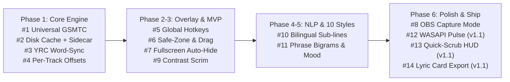

# LyricPulse Developer Additions & High-Leverage Differentiators

> **Purpose:** Concrete, high-leverage product and engineering improvements beyond the clean-room architectural baseline that our developers can integrate cleanly across **GSD Phases 1–6** without sacrificing LyricPulse's simplicity, zero-friction UX, or <150 MB / <3% idle CPU budget.  
> **Ranking Methodology:** Each addition is scored on **Impact** (`Transformative`, `High`, `Medium`) vs. **Effort** (`XS < 2h`, `S 2–6h`, `M 1–2d`, `L 2–4d`) and pinned to exact core interfaces and GSD phases.

---

## 1. Effort vs. Impact Priority Matrix

| Rank | Feature Addition | Impact | Effort | Target Phase | Priority Tier |
|---:|---|---|---|---|---|
| **1** | **Universal GSMTC Player Mode + Smart Browser/Video Filter** | Transformative | **S** | Phase 1 | **Must-Ship (v1.0)** |
| **2** | **Disk Lyrics Cache + Local `.lrc` Sidecar Override** | Transformative | **S** | Phase 1 | **Must-Ship (v1.0)** |
| **3** | **True Word-Synced YRC (NetEase) + Enhanced LRC Priority** | Transformative | **S** | Phase 1 | **Must-Ship (v1.0)** |
| **4** | **Per-Track Persisted Timing Offsets (Opt-In Memory)** | High | **XS** | Phase 1 / 3 | **Must-Ship (v1.0)** |
| **5** | **Global System Hotkeys (Toggle, Timing Nudge, Style Cycle)** | Transformative | **S** | Phase 2 / 3 | **Must-Ship (v1.0)** |
| **6** | **Custom Safe-Zone Screen Anchors & Unlock-to-Drag Placement** | Transformative | **M** | Phase 2 / 3 | **Must-Ship (v1.0)** |
| **7** | **Fullscreen Game & Presentation Auto-Hide (`SHQueryUserNotificationState`)** | High | **XS** | Phase 2 / 6 | **Must-Ship (v1.0)** |
| **8** | **OBS / Streamer Chroma-Key & Transparent Window Capture Mode** | High | **S** | Phase 2 / 6 | **Must-Ship (v1.0)** |
| **9** | **Adaptive Contrast Halo & Dynamic Scrim Protection** | High | **S** | Phase 2 / 5 | **Must-Ship (v1.0)** |
| **10** | **Bilingual Dual-Line Translation & Romanization Overlay** | High | **M** | Phase 4 / 5 | **Strong v1.0 / v1.1** |
| **11** | **Phrase-Level Semantic Word-Pictures & Song-Mood Fallback** | High | **S** | Phase 4 | **Strong v1.0 / v1.1** |
| **12** | **WASAPI Loopback Peak-Meter Audio Reactivity (Optional Pulse)** | High | **M** | Phase 5 / 6 | **Stretch (v1.1)** |
| **13** | **Hotkey Quick-Scrub Mini HUD (Click Lyric Line to Seek)** | Medium | **M** | Phase 5 / 6 | **Stretch (v1.1)** |
| **14** | **One-Click Shareable Lyric Poster Export (Skia PNG / Clipboard)** | Medium | **S** | Phase 6 | **Stretch (v1.1)** |

---

## 2. Detailed Feature Specifications (Mapped to GSD Phases 1–6)

### Phase 1 — Core Engine & Lyrics Intelligence Additions

#### 1. Universal GSMTC Player Mode + Smart Browser/Video Filter
- **Baseline Gap:** Locking strictly to Spotify and Apple Music excludes massive Windows audiences using YouTube Music (PWA / Chrome / Edge), Tidal, Qobuz, Amazon Music, MusicBee, foobar2000, Cider, and VLC.
- **What Developers Add:**
  - Expose `MediaSourcePolicy` (`SupportedPlayersOnly` vs. `UniversalFallback`) in `AppSettings` and `MediaSessionSelector`.
  - Add a **Smart Browser Music Heuristic**: when tracking browser AUMIDs (`chrome.exe`, `msedge.exe`, `brave.exe`, `firefox.exe`), ignore sessions reporting `MediaPlaybackType.Video` or missing `Artist` metadata (so YouTube coding tutorials or Twitch streams don't trigger false lyric searches), while allowing YouTube Music / SoundCloud / Bandcamp / Spotify Web Player cleanly.
  - Add a per-app **Ignore List** (`BlockedAppIds`, defaulting to `Discord.exe`, `Teams.exe`, `Zoom.exe`) editable in Settings.
- **Exact Hook:** `MediaSessionSelector.Select()` + `IMediaSessionProvider.UpdateSourcePolicy()`.
- **Effort / Impact:** **S / Transformative** — multiplies addressable user base ~3× with ~60 lines of pure C#.

#### 2. Disk Lyrics Cache + Local `.lrc` Sidecar Override
- **Baseline Gap:** Re-fetching HTTP lyrics every time a track loops wastes bandwidth, adds 200–800 ms startup delay, and breaks completely offline (flights, flaky Wi-Fi). Indie/unreleased tracks also lack public DB coverage.
- **What Developers Add:**
  - Implement `%LOCALAPPDATA%\LyricPulse\cache\lyrics\{shard}\{sha256}.json` with atomic writes, 90-day synced TTL, and 24-hour negative caching (specified in `CORE_ENGINE.md §3.5`).
  - Add a **Local Override Folder** (`%LOCALAPPDATA%\LyricPulse\custom-lyrics\`) checked **first** before network providers: users can drop `{Artist} - {Title}.lrc` (or click *"Import Custom .lrc"* in Tray/Settings for the currently playing song) to permanently fix or add lyrics for rare remixes/bootlegs.
- **Exact Hook:** `LocalSidecarLyricsProvider` (`PriorityOrder = 0`) + `FileLyricsCache : ILyricsCache`.
- **Effort / Impact:** **S / Transformative** — instant `< 2 ms` lyric startup on replays and full offline resilience.

#### 3. True Word-Synced YRC (NetEase) + Enhanced LRC Priority
- **Baseline Gap:** Baseline treats line-synced LRC with heuristic word splitting as the primary case. Many pop, K-Pop, J-Pop, and catalog songs already have **true millisecond syllable/word timings** via Enhanced LRC (`<mm:ss.xx>`) on LRCLIB or NetEase `yrc`.
- **What Developers Add:**
  - Request `yv=1` on NetEase `/api/song/lyric/v1` and prefer `yrc` over `lrc` whenever valid.
  - In `CandidateScorer`, award `+25` points to word-synced candidates vs. `+15` for line-synced candidates, and display a subtle badge (`Word-Sync` vs. `Line-Sync`) in Settings/Gallery diagnostics.
- **Exact Hook:** `ILyricsParser.ParseYrc()` + `SyncGranularity.WordNative`.
- **Effort / Impact:** **S / Transformative** — elevates `Fisheye`, `Codestyle`, `NodeLine`, and `KineticWall` from "estimated timing" to concert-grade syllable precision.

#### 4. Per-Track Persisted Timing Offsets
- **Baseline Gap:** Baseline resets timing offset (`±0.5s / ±1.0s`) on every track change. If a favorite remastered track is consistently 1.0s behind on Spotify, users hate re-nudging it every single play.
- **What Developers Add:**
  - Add a tiny AOT-safe JSON map `%LOCALAPPDATA%\LyricPulse\track-offsets.json` (`Dictionary<string, int>` mapping `TrackIdentity.CacheKey` → offset milliseconds, LRU-capped at 1,000 tracks).
  - Settings toggle: **"Remember timing offset per song"** (default `true`; disabling reverts cleanly to baseline auto-reset-on-track-change).
  - Add fine-grained nudge step (`±0.25s` via Shift+click or hotkey alongside `±0.5s` / `±1.0s`).
- **Exact Hook:** `TimingOffsetState` + `ITrackOffsetStore`.
- **Effort / Impact:** **XS / High** — eliminates the #1 repeat annoyance in desktop lyrics apps.

---

### Phase 2 & 3 — Overlay Host, Win32 Ergonomics & MVP UX Additions

#### 5. Global System Hotkeys (Zero-Focus Control)
- **Baseline Gap:** Reaching down to the Windows system tray to hide lyrics during a screen share or nudge timing mid-chorus breaks flow.
- **What Developers Add:**
  - Register optional, user-remappable Win32 global hotkeys via `RegisterHotKey` / `UnregisterHotKey` (`WM_HOTKEY` on a message-only window or Avalonia Win32 hook):
    - `Ctrl + Alt + L`: Show / Hide Lyrics Overlay instantaneously
    - `Ctrl + Alt + Left` / `Ctrl + Alt + Right`: Shift Timing Earlier (`+0.5s`) / Later (`-0.5s`) with a 1.5s non-intrusive HUD toast
    - `Ctrl + Alt + S`: Cycle Pinned Visual Styles live
    - `Ctrl + Alt + P`: Toggle Position Unlock (Drag-to-Place mode)
  - Gracefully report registration conflicts if another app owns a shortcut; zero low-level keyboard hooks (`WH_KEYBOARD_LL`) so antivirus/anti-cheat software never flags LyricPulse!
- **Exact Hook:** `IGlobalHotkeyService` in `LyricPulse.App.Platform.Windows`.
- **Effort / Impact:** **S / Transformative** — makes LyricPulse feel like a native pro Windows utility.

#### 6. Custom Screen Safe-Zone Anchors & Unlock-to-Drag Placement
- **Baseline Gap:** Fixed centered overlays collide with active documents, VS Code terminals, or video players.
- **What Developers Add:**
  - Provide **9-Point Safe-Zone Presets** (Top/Middle/Bottom × Left/Center/Right) computed strictly inside each monitor's `WorkingArea` (taskbar-aware, DPI-scaled).
  - Provide an **"Unlock Overlay Position"** toggle (Tray + `Ctrl+Alt+P`): temporarily removes `WS_EX_TRANSPARENT` + shows a subtle dashed bounding frame + resize handles so users can drag and resize the lyric viewport anywhere on any monitor, then re-locks click-through (`WS_EX_TRANSPARENT`) automatically on confirm or `Esc`.
  - Store normalized per-monitor coordinates `(AnchorX: 0..1, AnchorY: 0..1, WidthRatio, HeightRatio)` so layout survives DPI or resolution changes!
- **Exact Hook:** `OverlayBoundsConfig` in `AppSettings` + `IOverlayWindowPlatform.SetClickThrough(bool)`.
- **Effort / Impact:** **M / Transformative** — huge daily usability win for coding, studying, and ultrawide monitor users.

#### 7. Fullscreen Game & Presentation Auto-Hide (`SHQueryUserNotificationState`)
- **Baseline Gap:** Even click-through always-on-top overlays can interfere visually with fullscreen games, movies, or Zoom/Teams presentations (or force DWM out of Independent Flip low-latency presentation mode!).
- **What Developers Add:**
  - Poll lightweight Shell API `SHQueryUserNotificationState` (`shell32.dll`) every `1,500 ms` (cost: `< 0.01%` CPU, zero DLL injection, 100% anti-cheat safe!).
  - When `AutoHideInFullscreenGames == true` and state is `QUNS_RUNNING_D3D_FULL_SCREEN` or `QUNS_PRESENTATION_MODE` (optionally `QUNS_BUSY` for borderless fullscreen video/games on the active monitor): pause rendering (`0%` GPU/CPU) and hide that monitor's overlay window cleanly until normal desktop resumes.
- **Exact Hook:** `IFullscreenDetector` consumed by `OverlayHostController`.
- **Effort / Impact:** **XS / High** — prevents gamers from uninstalling LyricPulse over FPS drops or visual clutter.

#### 8. OBS / Streamer Broadcast & Chroma-Key Capture Mode
- **Baseline Gap:** Windows `WS_EX_TOOLWINDOW` + transparent layered desktop overlays are notoriously tricky for Twitch/YouTube streamers to capture cleanly in OBS Studio without capturing their desktop wallpaper behind it.
- **What Developers Add:**
  - Add a dedicated **"Streamer / OBS Capture Window"** mode (launchable from Tray/Settings):
    - Spawns a fixed-aspect (`1920×1080` or `1280×720`) normal window (omitting `WS_EX_TOOLWINDOW` so OBS **Window Capture** / Windows Graphics Capture lists `LyricPulse Broadcast` directly!).
    - Offers backdrop selector: **Transparent Alpha (WGC)**, **Chroma Green (`#00FF00`)**, **Chroma Blue (`#0000FF`)**, or **Solid Black (`#000000` for Screen/Add blend mode)**.
- **Exact Hook:** `BroadcastWindow` reusing the exact same `SkiaLyricCanvasControl` scene renderer!
- **Effort / Impact:** **S / High** — massive organic growth vector via Twitch/YouTube/TikTok creators showcasing LyricPulse's 10 kinetic styles.

#### 9. Adaptive Contrast Halo & Dynamic Scrim Protection
- **Baseline Gap:** Vibrant album accent colors (`AccentColor1..3`) can become unreadable when a user switches from a dark IDE to a bright white browser window or bright wallpaper.
- **What Developers Add:**
  - Combine our OKLCH luminance clamp (`CORE_ENGINE.md §5.1`) with an optional **"Readability Protection"** mode in `LyricPulse.Rendering`:
    - `None` (pure typography)
    - `SoftShadow` (default: dual-pass Skia drop shadow + subtle dark outline stroke calibrated to font weight)
    - `AdaptiveGlassPill` (soft radial frosted dark gradient backdrop `ScrimTint` behind active lines, smoothly fading out during instrumental gaps)
- **Exact Hook:** `AccentPalette.ScrimTint` + `RenderOptions.ReadabilityMode`.
- **Effort / Impact:** **S / High** — ensures WCAG-grade legibility on every wallpaper without compromising aesthetic minimalism.

---

### Phase 4 & 5 — Offline Semantic NLP, Multilingual & Style Gallery Additions

#### 10. Bilingual Dual-Line Translation & Romanization Overlay
- **Baseline Gap:** Global listeners play K-Pop, J-Pop, C-Pop, Spanish, French, and Hindi tracks constantly. NetEase `/api/song/lyric/v1` **already returns** `tlyric` (timestamped translation) and `romalrc` (timestamped romanization/pinyin/romaji) in the exact same JSON payload at zero extra network cost!
- **What Developers Add:**
  - Parse `tlyric` and `romalrc` and align them to primary `LyricLine` entries by timestamp proximity (`|Δt| <= 300 ms`), populating `LyricLine.TranslationText` and `LyricLine.RomanizedText` (already modeled in `CORE_ENGINE.md §6.1`!).
  - Render an optional subtle secondary sub-line (65% scale, 70% opacity) below the active line in styles where spatial layout supports it (`Messages`, `Codestyle`, `NodeLine`, `KineticWall`).
- **Exact Hook:** `ILyricsParser.ParseYrc()` / `LrcTranslationMerger` + `AppSettings.SecondaryLineMode` (`Off`, `Translation`, `Romanization`).
- **Effort / Impact:** **M / High** — standout differentiator for international music fans.

#### 11. Phrase-Level Semantic Word-Pictures & Song-Mood Ambient Fallback
- **Baseline Gap:** Single-word GloVe matching misses iconic two-word lyric idioms (`"broken heart"`, `"new york"`, `"shooting star"`, `"black hole"`, `"high school"`) and leaves abstract chorus lines (e.g., *"I can't let you go right now"*) completely iconless in `VisualStack` / `FisheyeVisual`.
- **What Developers Add:**
  - **Bigram Idiom Dictionary (~150 curated lyric phrases)**: run a zero-alloc adjacent-word check before unigram lookup (`"broken" + "heart"` → `💔` / Fluent HeartBroken; `"shooting" + "star"` → `🌠`; `"cold" + "shoulder"` → `❄️`; `"red" + "light"` → `🚦`).
  - **Song-Mood Fallback Vector**: when an entire line has zero word matches above threshold in visual-heavy styles (`VisualStack`), average the GloVe vectors of all content words in the line (or song title) to match 1 subtle mood glyph at threshold `>= 0.48`.
- **Exact Hook:** `IWordVisualMatcher.AnnotateDocument()`.
- **Effort / Impact:** **S / High** — dramatically improves perceived "intelligence" of the offline Word Pictures engine.

---

### Phase 5 & 6 — Delight, Audio Reactivity & Polish Additions

#### 12. Optional WASAPI Loopback Peak-Meter Audio Reactivity
- **Baseline Gap:** Kinetic styles animate purely from lyric timing clocks, missing the micro-rhythm of bass drops and vocal swells.
- **What Developers Add:**
  - Read system default audio render endpoint peak meter via Windows Core Audio `IAudioMeterInformation.GetPeakValue()` (zero audio recording, zero FFT CPU cost — literally reading a single `float [0..1]` scalar from Windows Audio Engine at 60 Hz!).
  - Feed a smoothed exponential envelope (`attack = 0.35`, `release = 0.08`) into `RenderFrameContext.AudioEnergy` to subtly breathe `Fisheye` lens bulge strength (`+8%`), `Constellation` star glow radius, and `NodeLine` pulse brightness.
  - Strictly **disabled** when `ReducedMotion == true` and opt-in via Settings toggle.
- **Exact Hook:** `IAudioEnergyProvider` (`WasapiPeakMeterProvider`, COM `MMDeviceEnumerator` + `IAudioMeterInformation`).
- **Effort / Impact:** **M / High** — makes LyricPulse feel truly alive with the music at `< 0.2%` CPU.

#### 13. Hotkey Quick-Scrub Mini HUD (Click Any Lyric Line to Seek)
- **Baseline Gap:** Click-through overlays intentionally cannot accept mouse clicks, so jumping back to a favorite verse still requires alt-tabbing back to Spotify/Apple Music.
- **What Developers Add:**
  - Pressing a quick hotkey (e.g., `Ctrl + Alt + Space`) or clicking the Tray icon opens a compact, translucent **Mini Lyric Scrubber** showing a scrollable list of the song's lyrics + transport buttons (`Prev`, `Play/Pause`, `Next`).
  - Clicking any lyric line calls GSMTC `session.TryChangePlaybackPositionAsync(line.StartTime.Ticks)` — instantly seeking Spotify/Apple Music straight to that lyric!
- **Exact Hook:** `IMediaSessionProvider.TrySeekAsync(TimeSpan)` / `TryTogglePlayPauseAsync()`.
- **Effort / Impact:** **M / Medium** — unlocks interactive lyric navigation without ever compromising click-through overlay safety.

#### 14. One-Click Shareable Lyric Poster Export (Skia PNG / Clipboard)
- **Baseline Gap:** Users frequently screenshot kinetic lyrics to share on Discord, X, or Instagram Stories, often capturing messy desktop icons behind them.
- **What Developers Add:**
  - Reuse `LyricPulse.Rendering`'s exact SkiaSharp scene renderer on an offscreen `SKSurface.Create(new SKImageInfo(1080, 1080))` backed by a smooth mesh gradient from `AccentPalette` + active track attribution footer (`Title — Artist`).
  - Trigger via Tray menu (*"Copy Current Lyric Card"*) or hotkey → copies crisp PNG directly to Windows Clipboard and optionally saves to `Pictures\LyricPulse\`.
- **Exact Hook:** `ILyricCardExporter` using existing `ILyricSceneRenderer` + `AccentPalette`.
- **Effort / Impact:** **S / Medium** — zero new graphics code required; instant viral shareability.

---

## 3. Recommended Phase Adoption Schedule

### Guardrails for Developers Adopting Additions
1. **Zero Feature Creep in Core Contracts**: All Phase 4–6 additions plug into optional properties already reserved on `AppSettings`, `LyricLine`, and `RenderFrameContext` — never break Phase 1–3 interfaces.
2. **Strict Performance Budget**: Every addition MUST keep idle CPU `< 3%`, active 60 FPS GPU/CPU overhead minimal, and total working set `< 150 MB`.
3. **Accessibility First**: Audio reactivity (#12) and intense motion effects MUST automatically respect `AppSettings.ReducedMotion` and OS `SPI_GETCLIENTAREAANIMATION`.
4. **TDD Gate**: Every core addition (#1–#4, #10–#11) requires ≥80% unit test coverage in `LyricPulse.Tests` before merging into the phase completion milestone.
