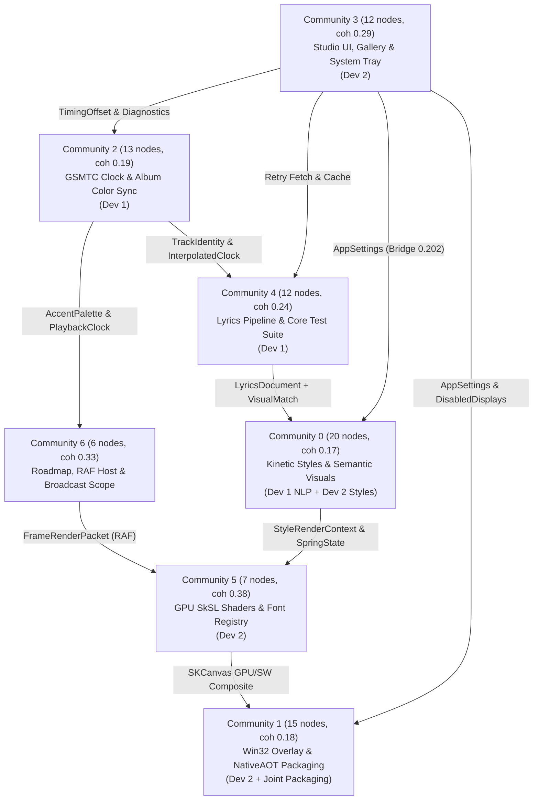

# LyricPulse — Graphify Knowledge Graph & Developer Integration Plan Report

> **Audience:** Developer 1 (`LyricPulse.Core` + `LyricPulse.Tests`) & Developer 2 (`LyricPulse.Rendering` + `LyricPulse.UI` + `LyricPulse.App`)  
> **Graph Artifacts:** [`graphify-out/graph.json`](../../graphify-out/graph.json) · [`graphify-out/GRAPH_REPORT.md`](../../graphify-out/GRAPH_REPORT.md) · [`graphify-out/graph.html`](../../graphify-out/graph.html)  
> **Cross-Referenced Specs:** `PROJECT.md`, `REVERSE_ENGINEERING_BASELINE.md`, `CORE_ENGINE.md`, `RENDERING_AND_WIN32.md`, `DEVELOPER_ADDITIONS.md`, `MASTER.md`, `MOTION_AND_STYLES.md`, `gallery.md`, `settings.md`, `tray.md`.

---

## 1. Knowledge Graph Statistics & Integrity Audit

| Metric | Value | Status |
|---|---|---|
| **Corpus Indexed** | 11 files (10 Markdown specifications + `.planning/config.json`, ~36,414 words) | All 10 docs stamped in `manifest.json` |
| **Graph Topology** | **85 nodes · 161 unique undirected edges · 7 communities · 8 hyperedges** | Connected & balanced |
| **Edge Provenance** | **79% `EXTRACTED`** (127) · **16% `INFERRED`** (25, avg confidence `0.89`) · **6% `AMBIGUOUS`** (9) | Honest audit trail |
| **Graph Health Check (Step 4.5)** | `missing_endpoint_edges: 0` · `dangling_endpoint_edges: 0` · `self_loop_edges: 0` · `collapsed_edges: 0` | **PASS — OK** |

The **9 `AMBIGUOUS` edges** in the graph are not extraction errors — they intentionally isolate **real cross-document contract conflicts** discovered across Wave-1 research and design specifications so developers resolve them on Day 1 rather than during Phase 3 integration debugging.

---

## 2. God Nodes & Cross-Community Bridges (Protect with Strict Interfaces)

### 2.1 Top 10 God Nodes (Highest Structural Degree)

| Rank | God Node | Degree | Community | Primary Owner | Interface / Boundary Contract to Protect |
|---:|---|---:|---|---|---|
| 1 | **`Damped Harmonic Spring & Easing Token System`** | 10 | Kinetic Styles & Semantic Visuals | Dev 2 | `LyricPulse.Rendering.Physics.SpringState` + static `SpringTokens` (fixed `1/240s` substep, `dt <= 33.3ms`, rest threshold `<0.001`) |
| 2 | **`Multi-Provider Lyrics Pipeline (ILyricsOrchestrator)`** | 9 | Lyrics Pipeline & Core Test Suite | Dev 1 | `ILyricsOrchestrator` + ordered `IEnumerable<ILyricsProvider>` (Local Sidecar → Cache → LRCLIB → NetEase) |
| 3 | **`Acoustic Studio Lightbox Design System (MASTER.md)`** | 9 | Studio UI, Gallery & System Tray | Dev 2 | `Themes/LyricPulseTokens.axaml` (`ThemeDictionaries` Dark/Light + `{DynamicResource}` only, zero emojis in chrome) |
| 4 | **`IWordVisualMatcher (SIMD TensorPrimitives.Dot)`** | 8 | Kinetic Styles & Semantic Visuals | Dev 1 → Dev 2 | `IWordVisualMatcher` returning immutable `VisualMatch?` (`StarterLexicon` zero-download fallback + `FullSemanticGloVe`) |
| 5 | **`AppSettings Immutable Domain Model`** | 8 | Studio UI, Gallery & System Tray | **Joint (Dev 1 + Dev 2)** | `AppSettings` `sealed record` + `ISettingsStore` (highest betweenness bridge `0.202`, touching **6 of 7 communities**) |
| 6 | **`Multi-Monitor & Per-Monitor V2 DPI Overlay Coordinator`** | 8 | Win32 Overlay & NativeAOT Packaging | Dev 2 | `IOverlayWindowPlatform` + `OverlayHostCoordinator` (`app.manifest` PerMonitorV2, `GetDpiForMonitor`, 250ms hotplug debounce) |
| 7 | **`SkSL Shader Uniform Animation Curves (Motion Spec)`** | 8 | Kinetic Styles & Semantic Visuals | Dev 2 | Unified `IShaderPipeline` contract inside `RenderResourceCache` (reconciling `RENDERING_AND_WIN32.md` & `MOTION_AND_STYLES.md`) |
| 8 | **`SettingsView Inline/Overlay Drawer`** | 7 | Studio UI, Gallery & System Tray | Dev 2 | `SettingsView.axaml` (`x:DataType` compiled bindings, inline ≥880px / overlay <880px, atomic debounced save) |
| 9 | **`Five-Project Solution Topology`** | 6 | Lyrics Pipeline & Core Test Suite | **Joint** | Strict acyclic dependency graph: `Core` ← `Rendering` ← `UI` ← `App`, with `Tests` referencing `Core` + `Rendering` |
| 10 | **`NativeAOT & Self-Contained Publish Profiles`** | 6 | Win32 Overlay & NativeAOT Packaging | **Joint** | `Directory.Build.props` + `Directory.Packages.props` (`CsWinRTAotOptimizerEnabled`, `AvaloniaUseCompiledBindingsByDefault`, `[LibraryImport]`, `[JsonSerializable]`) |

### 2.2 Top Betweenness-Centrality Bridge Nodes

1. **`AppSettings Immutable Domain Model` (Betweenness = `0.202`)** — Bridges **6 communities** (`Studio UI` ↔ `Kinetic Styles`, `Win32 Overlay`, `GSMTC Clock`, `Lyrics Pipeline`, `Roadmap`). **Rule:** Finalize the complete v1 `AppSettings` record schema in Phase 1 (including fields needed in Phases 2–6) so later phases never break JSON backward compatibility or trigger cascading refactors.
2. **`Global Reduced Motion Accessibility Contract` (Betweenness = `0.112`)** — Bridges **3 communities** (`Kinetic Styles`, `Studio UI`, `GPU SkSL Shaders`). **Rule:** Model as a single reactive boolean `EffectiveReducedMotion = AppSettings.ReducedMotion || !SystemAnimationsEnabled` injected into `FrameRenderPacket`, `GalleryWindow` previews, and `SettingsView` chrome transitions.

---

## 3. Architectural Community Map

| Community | Nodes | Cohesion | Core Architectural Responsibility | Lead Owner |
|---|---:|---:|---|---|
| **0. Kinetic Styles & Semantic Visuals** | 20 | `0.17` | 10 kinetic style renderers, 4-layer legibility, spring tokens, Reduced Motion, `Neon Horizon` demo song, SIMD Word-Pictures matcher | Dev 2 (Styles) + Dev 1 (NLP) |
| **1. Win32 Overlay & NativeAOT Packaging** | 15 | `0.18` | Click-through Win32 `[LibraryImport]`, multi-monitor Per-Monitor V2 DPI, `DirectComposition` guard, `AppBuilder`, `Directory.Packages.props`, NativeAOT/CsWinRT | Dev 2 + Dev 1 (Packaging) |
| **2. GSMTC Clock & Album Color Sync** | 13 | `0.19` | `IMediaSessionProvider`, Spotify/Apple Music priority + hysteresis, `Stopwatch` interpolation, `TimingOffsetState`, OKLab album extractor, Gallery media bar | Dev 1 + Dev 2 (Media Bar) |
| **3. Studio UI, Gallery & System Tray** | 12 | `0.29` | `MASTER.md` WCAG tokens, `GalleryWindow`, `SettingsView`, `TrayController` (`NativeMenu`), `AppSettings`, `SingleInstanceGuard` | Dev 2 |
| **4. Lyrics Pipeline & Core Test Suite** | 12 | `0.24` | `ILyricsOrchestrator`, LRCLIB, NetEase YRC/LRC, `TitleNormalizer`, sharded disk cache, `LyricsJsonContext`, `LyricPulse.Tests` (≥80%) | Dev 1 |
| **5. GPU SkSL Shaders & Font Registry** | 7 | `0.38` | `LyricDrawOperation`, `RenderResourceCache`, `EllipticalBulge`, `DirectionalMotionBlur`, `FontAssetRegistry`, HarfBuzz shaping, telemetry | Dev 2 |
| **6. Roadmap, RAF Host & Broadcast Scope** | 6 | `0.33` | Vision, 6-phase plan, `<3% CPU / <150 MB` budget, `LyricCanvasControl` RAF host, Universal GSMTC & OBS Broadcast scope | Joint |

---

## 4. Surprising Connections & Cross-Document Risks (MUST RESOLVE BEFORE CODING)

Graphify's **Surprising Connections** and **9 Ambiguous Edges** exposed **8 concrete cross-document drifts** between Wave-1 research and design specs. Below are the **binding resolution decisions** for Developer 1 and Developer 2:

### Risk 1 — Timing Offset Sign Inversion *(CRITICAL — `gallery.md`/`tray.md`/`settings.md` vs `CORE_ENGINE.md`)*
- **Conflict Detected:**
  - `CORE_ENGINE.md` §3.7 defines `EffectiveLyricTime = PlaybackPosition + TimingOffset`, where **`+0.5s` = Earlier** and **`-0.5s` = Later** (`DEVELOPER_ADDITIONS.md` §5 agrees).
  - `gallery.md` §2.2, `settings.md` §7, and `tray.md` §4.1 label **`−0.5s / −1.0s` = Earlier** and **`+0.5s / +1.0s` = Later**!
- **Binding Resolution:** Standardize on **timestamp-shift semantics across ALL layers** (matching `gallery.md`, `settings.md`, `tray.md`, and VLC/mpv user intuition):
  - **`−0.5s` / `−1.0s` = Lyrics appear EARLIER** (shifts lyric cue timestamps earlier by 0.5s / 1.0s).
  - **`+0.5s` / `+1.0s` = Lyrics appear LATER** (delays lyric cue timestamps by 0.5s / 1.0s).
  - **Canonical Formula (Dev 1):** `EffectiveLyricTime = Clamp(InterpolatedPlaybackPosition - TimingOffset, TimeSpan.Zero, TrackDuration)` (equivalently, cue fires when `PlaybackPosition >= Word.StartTime + TimingOffset`).
  - **Mandatory Unit Test:** Assert that with `TimingOffset = -0.5s` ("Earlier"), a lyric line at `10.0s` activates at `PlaybackPosition = 9.5s`.

### Risk 2 — SkSL Shader Uniform Names, Optical Sign & Angle Safety *(HIGH — `RENDERING_AND_WIN32.md` vs `MOTION_AND_STYLES.md`)*
- **Conflict Detected:**
  - `RENDERING_AND_WIN32.md` §3.1 uses `size`, `strength` (negative = convex bulge), `power`, and `velocity` (`<= 160px`), with `pow(max(r, 1e-4), power)` NaN guard and `SKShaderTileMode.Decal`.
  - `MOTION_AND_STYLES.md` §5.1 uses `iCenter`, `iSize`, `iStrength` (positive `0.24..0.40` resting/ceiling), `iPower` (`2.10`), and `iVelocity` (hyperbolic `tanh` clamp `<= 22px * dpiScale` over fixed `/60f` reference), without the `r > 0.0001` NaN guard.
- **Binding Resolution (Dev 2):** Unify into one authoritative shader contract:
  - **Uniforms:** `EllipticalBulge.sksl` uses `content`, `iCenter`, `iSize`, `iStrength`, `iPower`; `DirectionalMotionBlur.sksl` uses `content`, `iVelocity`.
  - **Math & Safety:** Combine `RENDERING_AND_WIN32.md`'s ANGLE-safe guards (`r > 0.0001`, `factor >= 0.15`, `SKShaderTileMode.Decal`, `SKAlphaType.Premul`) with `MOTION_AND_STYLES.md`'s comfort clamps (`iStrength ∈ [0.00, 0.40]`, `iVelocity` hyperbolic `tanh` clamp `<= 22px * dpiScale` at fixed `60f` shutter divisor).
  - **Convex Bulge Optical Sign Lock:** In `EllipticalBulge.sksl`, write `float factor = max(1.0 - abs(iStrength) * radial, 0.15);` so positive `iStrength = 0.24..0.36` mathematically samples closer to `iCenter` (**true convex magnification bulge**) — never concave pincushion!

### Risk 3 — OKLab / OKLCH Album Palette Extraction Divergence *(HIGH — `CORE_ENGINE.md` vs `MOTION_AND_STYLES.md`)*
- **Conflict Detected:**
  - `CORE_ENGINE.md` §5.1 uses `K = 8`, SHA-256 deterministic PRNG seed, `SKSamplingOptions(Linear)`, uniform lightness clamp `L ∈ [0.64, 0.88]`, monochrome `max C < 0.045`, and default Electric Violet (`#7C5CFF`).
  - `MOTION_AND_STYLES.md` §2.1–2.2 uses `K = 6`, fixed seed `42`, obsolete SkiaSharp 2.x `SKFilterQuality.Medium`, role-specific lightness clamps (`Accent1 [0.78, 0.92]`, `Accent2 [0.66, 0.82]`, `Accent3 [0.62, 0.76]`), `≥38°` hue separation, monochrome `C_p85 < 0.035`, and default Studio palette (`#F8FAFC` / `#818CF8` / `#94A3B8`).
- **Binding Resolution (Dev 1):** Implement ONE `SkiaAlbumColorExtractor` in `LyricPulse.Core`:
  - Use **SkiaSharp 3.x `SKSamplingOptions(SKFilterMode.Linear, SKMipmapMode.None)`** (NEVER deprecated `SKFilterQuality.Medium`).
  - Use **`K = 8`** with **SHA-256 deterministic seed** + `64,000,000` pixel decompression-bomb guard (`CORE_ENGINE.md`).
  - Enforce **`MOTION_AND_STYLES.md`'s role-specific OKLCH clamps** (`Accent1 L∈[0.78,0.92]`, `Accent2 L∈[0.66,0.82]` with `≥38°` hue sep, `Accent3 L∈[0.62,0.76] C∈[0.04,0.12]`, `ScrimTint L∈[0.14,0.22]`) so the ≥9.0:1 white-webpage contrast proof holds deterministically.
  - Set `AccentPalette.Default` to the harmonized `MASTER.md`/`MOTION_AND_STYLES.md` Studio fallback (`#F8FAFC`, `#818CF8`, `#94A3B8`, `#0F0F23`).

### Risk 4 — Avalonia, SkiaSharp & `.NET 10` ABI Lockstep *(HIGH — `PROJECT.md` / `CORE_ENGINE.md` / `RENDERING_AND_WIN32.md`)*
- **Conflict Detected:** `PROJECT.md` & `MASTER.md` reference `.NET 9`, while `CORE_ENGINE.md` & `RENDERING_AND_WIN32.md` target `.NET 10` (`net10.0-windows10.0.19041.0`); `CORE_ENGINE.md` §1.2 lists `SkiaSharp 3.119.0` alongside `SkiaSharp.NativeAssets.Win32 3.119.4` (patch mismatch!).
- **Binding Resolution (Joint):**
  - Target **`net10.0-windows10.0.19041.0`** across all 5 projects (matching the installed .NET 10 runtime once .NET 10 SDK is installed via winget).
  - Unify **`Directory.Packages.props`** with `CentralPackageTransitivePinningEnabled=true`: `Avalonia* 11.3.19`, `SkiaSharp 3.119.4`, `SkiaSharp.HarfBuzz 3.119.4`, `SkiaSharp.NativeAssets.Win32 3.119.4`, `HarfBuzzSharp 8.3.1.5`, `HarfBuzzSharp.NativeAssets.Win32 8.3.1.5`.
  - Enforce `SKFont` everywhere (zero deprecated `SKPaint.TextSize` or `SKFilterQuality` calls).

### Risk 5 — Font Asset Assembly URI Ownership *(MEDIUM — `MASTER.md` vs `RENDERING_AND_WIN32.md`)*
- **Conflict Detected:** `MASTER.md` §4.2 cites `avares://LyricPulse.UI/Assets/Fonts/Jost-Bold.ttf#Jost`, while `RENDERING_AND_WIN32.md` §5.2 bundles fonts in `avares://LyricPulse.Rendering/Assets/Fonts/`.
- **Binding Resolution (Dev 2):** Bundle all 4 static SIL OFL TTFs + `FluentSystemIcons-Filled.ttf` **once** inside **`LyricPulse.Rendering/Assets/Fonts/`** as `<AvaloniaResource>`. Register `LyricPulseFontCollection` (`fonts:LyricPulse` → `avares://LyricPulse.Rendering/Assets/Fonts`) in `AppBuilder.ConfigureFonts` so XAML uses `fonts:LyricPulse#Jost` and Skia loads via `SKData.Create(AssetLoader.Open(...))` → `SKTypeface.FromData(...)`.

### Risk 6 — Custom Color Role Labels in `SettingsView` *(MEDIUM — `settings.md` vs `MOTION_AND_STYLES.md`)*
- **Conflict Detected:** `settings.md` §3.3 labels `AccentColor2` as "Highlight / Active (Currently singing word)" and `AccentColor1` as "Primary Lyric", reversing `MOTION_AND_STYLES.md` §2.2 where `AccentColor1` is the **Active Hero Word** and `AccentColor2` is **Secondary Glow / Semantic Icons / Keywords**.
- **Binding Resolution (Dev 2):** Update `SettingsView.axaml` swatch labels to match `MOTION_AND_STYLES.md`:
  - `AccentColor1` → **Active Word (Primary Hero)**
  - `AccentColor2` → **Icons, Glow & Highlights**
  - `AccentColor3` → **Context Lines & Threads**

### Risk 7 — Global Hotkey Defaults & Safe-Zone Anchor Schema *(MEDIUM — `settings.md` vs `DEVELOPER_ADDITIONS.md`)*
- **Conflict Detected:** `settings.md`/`gallery.md`/`tray.md` specify `Ctrl+Shift+L/S/[/]/G` + 5-Zone Safe Anchor Grid; `DEVELOPER_ADDITIONS.md` specifies `Ctrl+Alt+L/S/Left/Right/P` + 9-Point Anchor Grid + Unlock-to-Drag.
- **Binding Resolution (Dev 2):**
  - Lock **`Ctrl+Shift+...`** defaults (`Ctrl+Shift+L` Toggle, `Ctrl+Shift+S` Cycle Styles, `Ctrl+Shift+[` Earlier, `Ctrl+Shift+]` Later, `Ctrl+Shift+G` Gallery, `Ctrl+Shift+P` Unlock-to-Drag) via Win32 `RegisterHotKey` (zero `WH_KEYBOARD_LL`).
  - Back the UI's 5-Zone quick grid with normalized per-monitor `OverlayBoundsConfig(AnchorX, AnchorY, WidthRatio, HeightRatio, SafeMarginPx)` so Phase 2/3 Unlock-to-Drag works on the exact same model without schema migration.

### Risk 8 — Missing Fields on `AppSettings` (`CORE_ENGINE.md` §6.1) & FontScale Formula *(MEDIUM)*
- **Gap Detected:** `settings.md` and `MOTION_AND_STYLES.md` require settings not yet declared on `CORE_ENGINE.md`'s `AppSettings` record, and `FontScale` (`0.60..1.60`) needs explicit mapping to `MOTION_AND_STYLES.md`'s `FontSize` (`24..96px`).
- **Binding Resolution (Dev 1 + Dev 2):** Add these immutable fields to `AppSettings` in Phase 1:
  - `ThemeVariantMode` (`System | Dark | Light`)
  - `ScrimIntensity` (`Off | Subtle | Balanced | Strong`) & `HighContrastScrim` (`bool`)
  - `OverlayBoundsConfig` (`AnchorZone`, `SafeMarginPx`, per-display normalized drag rect overrides)
  - `ImmutableDictionary<HotkeyAction, string> GlobalHotkeys`
  - `bool HideDuringInstrumentals` & `SecondaryLineMode` (`Off | Translation | Romanization`)
  - **Canonical Font Formula:** `effectiveFontSizeDip = 48.0 * Math.Clamp(settings.FontScale, 0.60, 1.60)` (floor `36.0` for `BodoniModa-Bold` to prevent hairline shimmer).

---

## 5. Prioritized Feature Additions Schedule (Cross-Referencing `DEVELOPER_ADDITIONS.md`)

| Phase | Developer 1 (`Core` + `Tests`) | Developer 2 (`Rendering` + `UI` + `App`) | Exit Verification Gate |
|---|---|---|---|
| **Phase 1: Core Engine & Contracts** | Implement `IMediaSessionProvider` + **#1 Universal GSMTC + Smart Browser/Video Filter**, `ILyricsOrchestrator` + **#2 Disk Cache + Local `.lrc` Sidecar**, **#3 NetEase YRC + Enhanced LRC Priority**, **#4 Per-Track Persisted Offsets (`ITrackOffsetStore`)**, `SkiaAlbumColorExtractor` (unified OKLCH), and complete v1 `AppSettings` + `Neon Horizon` demo asset. | Scaffold `Directory.Packages.props` (`Avalonia 11.3.19` + `SkiaSharp 3.119.4`), `LyricPulse.Rendering` font bundle (`Assets/Fonts/`), and `FontAssetRegistry`. | `dotnet test` ≥80% Core coverage; Timing offset sign test & OKLCH contrast tests green. |
| **Phase 2: Overlay Host & GPU Shaders** | Provide lock-free `GetInterpolatedPosition()` + reactive `LyricSceneSnapshot` feed. | Build `LyricCanvasControl` (RAF + idle zero-burn), `LyricDrawOperation`, `RenderResourceCache`, unified `EllipticalBulge` + `DirectionalMotionBlur` SkSL shaders, 4-Layer Legibility + **#9 Adaptive Scrim Protection**, Win32 click-through (`DirectComposition` guard + no `Maximized`), `MultiMonitorDpiCoordinator`, `SingleInstanceGuard`, **#5 Global Hotkeys (`RegisterHotKey`)**, and **#7 Fullscreen Auto-Hide (`SHQueryUserNotificationState`)**. | Headless SkSL shader compile tests pass; Win10/11 click-through & shadow-free smoke test green. |
| **Phase 3: 3-Style MVP, Gallery & Tray** | Wire settings persistence (`ISettingsStore`), track-offset store, and diagnostic telemetry into UI ViewModels. | Ship **3 MVP Styles** (`Fisheye`, `Codestyle`, `Constellation`), `MASTER.md` `LyricPulseTokens.axaml` (Dark/Light), `GalleryWindow` (30/60 FPS staggered cards + Diagnostics flyout), `SettingsView` drawer, `TrayController` (`NativeMenu`), and **#6 Safe-Zone Anchors + Unlock-to-Drag Placement**. | End-to-end live Spotify/Apple Music + Demo MVP verified; WCAG 2.2 AA/AAA contrast audit passes. |
| **Phase 4: Offline Semantic NLP & Visual Styles** | Ship `build_semantic_assets.py` (GloVe 100d int8 + All-but-the-Top PCA), `IWordVisualMatcher` (`TensorPrimitives.Dot` + `StarterLexicon`), **#11 Phrase Bigram Idioms & Song-Mood Fallback**, and **#10 Bilingual `tlyric`/`romalrc` Alignment** on `LyricLine`. | Ship **Visual Styles** (`FisheyeVisual`, `CodestyleVisual`, `VisualStack`) + optional bilingual sub-line rendering where layout permits. | Offline 12-keyword `Neon Horizon` coverage test passes with 0 network calls; SIMD dot parity `±1e-5`. |
| **Phase 5: Full 10-Style Parity** | Tune performance, negative cache pruning, and integration tests across all 10 style inputs. | Ship remaining **4 Styles** (`SpidersWeb`, `NodeLine`, `KineticWall` 3D `SKMatrix44`, `Messages` fixed chat thread) + `ReducedMotion` fallbacks across all 10 styles. | All 10 styles pass White-Page (`#FFFFFF`) & Dark-IDE (`#0D0D14`) legibility + spring determinism gates. |
| **Phase 6: Polish, Broadcast & Publish** | Coverage verification (≥80% across Core & Rendering), NativeAOT JSON/CsWinRT audit. | Ship **#8 OBS / Streamer Broadcast Window** (reusing `LyricCanvasControl`), 10-min performance soak test (`P95 < 6ms`, `<150 MB`, `<3% idle CPU`), and verified **NativeAOT + Self-Contained Single-File** Windows release packages. | *(v1.1 Stretch Backlog cleanly deferred unless ahead of schedule: **#12 WASAPI Peak-Meter**, **#13 Quick-Scrub Mini HUD**, **#14 Skia Lyric Poster PNG Export**).* |

---

## 6. Knowledge Gaps & Weakly-Connected Components to Monitor

Graphify flagged **10 weakly-connected leaf nodes** (`degree <= 1`) that should stay cleanly isolated or gain explicit wiring during implementation:
- **Intentional Leaf Utilities (Keep Decoupled):** `TitleNormalizer`, `Local .lrc Sidecar`, `Phrase Bigram Fallback`, `WASAPI Audio Reactivity`, `Quick-Scrub Mini HUD`, `Lyric Poster Export`.
- **Must Gain Concrete Wiring in Phase 2–3:**
  - `Fullscreen Game/Presentation Auto-Hide (SHQueryUserNotificationState)` → wire explicitly into `SettingsView` (`Overlay & Appearance` toggle) AND `OverlayHostCoordinator` pause gate.
  - `Global System Hotkeys (RegisterHotKey)` → wire explicitly into `TrayController` (dynamic menu gesture hints) AND `SettingsView` keycap conflict error banners.
  - `SingleInstanceGuard` → wire explicitly into `Program.Main` exit hook alongside `TrayController.Dispose()` so `Quit LyricPulse` releases both mutex and tray icon deterministically.
