# LyricPulse — Graphics, SkiaSharp/SkSL Rendering, Win32 Interop & Packaging Specification

> **Role**: Implementation-ready architecture & engineering reference for `LyricPulse.Rendering`, `LyricPulse.UI`, and `LyricPulse.App`.  
> **Target OS**: Windows 10 22H2 (19045)+ and Windows 11 (22H2–24H2+), `win-x64` (primary) and `win-arm64`.  
> **Target Runtime**: `.NET 10` (`net10.0-windows10.0.19041.0`, matching installed host runtime `10.0.x`; 100% source-compatible with `net9.0-windows10.0.19041.0` if `.planning/PROJECT.md` stays on .NET 9 LTS/STS).  
> **Performance Contract**: 60+ FPS active overlay rendering (≤ 16.67 ms/frame budget, P95 ≤ 6 ms GPU draw), < 3% idle CPU, < 150 MB working set, zero per-frame managed GC spikes in the render loop.

---

## 1. NuGet Package Matrix, AppBuilder Setup & NativeAOT / Self-Contained Packaging

### 1.1 Critical Compatibility Advisory: Avalonia 11.3.x + SkiaSharp 3.119.x

`Avalonia.Skia` `11.3.x` transitively declares `SkiaSharp >= 2.88.9`, whereas full native SkiaSharp 3 defaults land in Avalonia 12. Starting in **Avalonia `11.3.6+`**, Avalonia added patch-level compatibility for **SkiaSharp `3.119.x`**, **provided** that every managed wrapper and Windows native asset package is explicitly unified at the same `3.119.x` version via Central Package Management (`Directory.Packages.props`).

**Never allow mixed `2.88.x` and `3.119.x` assemblies in the dependency graph** — doing so triggers `TypeInitializationException` inside `SkiaSharpVersion.CheckNativeLibraryCompatible` or `DllNotFoundException` for `libSkiaSharp.dll` at startup.

### 1.2 Central Package Management (`Directory.Packages.props`)

Use `ManagePackageVersionsCentrally` at the solution root to guarantee identical versions across `LyricPulse.Core`, `LyricPulse.Rendering`, `LyricPulse.UI`, `LyricPulse.App`, and `LyricPulse.Tests`:

```xml
<Project>
  <PropertyGroup>
    <ManagePackageVersionsCentrally>true</ManagePackageVersionsCentrally>
    <CentralPackageTransitivePinningEnabled>true</CentralPackageTransitivePinningEnabled>
  </PropertyGroup>

  <ItemGroup>
    <!-- Avalonia 11.3.x (latest stable 11.3 patch; verify exact patch on restore) -->
    <PackageVersion Include="Avalonia" Version="11.3.19" />
    <PackageVersion Include="Avalonia.Desktop" Version="11.3.19" />
    <PackageVersion Include="Avalonia.Skia" Version="11.3.19" />
    <PackageVersion Include="Avalonia.Win32" Version="11.3.19" />
    <PackageVersion Include="Avalonia.Themes.Fluent" Version="11.3.19" />
    <PackageVersion Include="Avalonia.Controls.ColorPicker" Version="11.3.19" />
    <PackageVersion Include="Avalonia.Fonts.Inter" Version="11.3.19" />
    <PackageVersion Include="Avalonia.Diagnostics" Version="11.3.19" />

    <!-- SkiaSharp 3.119.x unified override (managed + HarfBuzz + Win32 native) -->
    <PackageVersion Include="SkiaSharp" Version="3.119.4" />
    <PackageVersion Include="SkiaSharp.HarfBuzz" Version="3.119.4" />
    <PackageVersion Include="SkiaSharp.NativeAssets.Win32" Version="3.119.4" />

    <!-- HarfBuzzSharp 8.3.x aligned with SkiaSharp 3.119.x -->
    <PackageVersion Include="HarfBuzzSharp" Version="8.3.1.5" />
    <PackageVersion Include="HarfBuzzSharp.NativeAssets.Win32" Version="8.3.1.5" />
  </ItemGroup>
</Project>
```

> **SkiaSharp 3.x Mandatory API Rule (`SKFont` vs `SKPaint`)**:
> SkiaSharp `3.119.x` deprecates and removes typography properties from `SKPaint` (`paint.TextSize`, `paint.Typeface`, `paint.TextAlign`, `canvas.DrawText(string, x, y, SKPaint)`).
> - **Always** configure typography on `SKFont` (`new SKFont(typeface, size)`) and draw with `canvas.DrawText(text, x, y, SKTextAlign.Center, font, paint)` or `SKShaper` (`SkiaSharp.HarfBuzz`).
> - **Never** call parameterless `new SKFont()` without assigning a typeface (it initializes to `SKTypeface.Empty` and renders invisible glyphs).
> - **Contingency Pin**: If a CI smoke test ever reveals an ABI incompatibility between a specific `Avalonia.Skia 11.3.x` patch and `SkiaSharp 3.119.x`, the entire solution can deterministically revert via one edit in `Directory.Packages.props` (`SkiaSharp 2.88.9` + `HarfBuzzSharp 7.3.0.3`), because all custom rendering uses `SKFont`, `SKRuntimeEffect.CreateShader`, and `SKData.Create(Stream)` which exist in both 2.88.9 and 3.119.x.

### 1.3 Project-Level Package Mapping

| Project | Direct Package References | Notes |
|---|---|---|
| `LyricPulse.Core` | *(zero Avalonia/Skia UI deps; `SkiaSharp` only if album color extraction lives here, or keep color extraction in a thin `SkiaAlbumPaletteExtractor` in `LyricPulse.Rendering`)* | Keeps `Core` headless & ultra-fast to unit test |
| `LyricPulse.Rendering` | `Avalonia`, `Avalonia.Skia`, `SkiaSharp`, `SkiaSharp.HarfBuzz`, `HarfBuzzSharp` | Custom `ICustomDrawOperation`, SkSL shaders, 10 style renderers, font registry |
| `LyricPulse.UI` | `Avalonia`, `Avalonia.Themes.Fluent`, `Avalonia.Controls.ColorPicker`, `Avalonia.Fonts.Inter`, `LyricPulse.Rendering` | `OverlayWindow`, `GalleryWindow`, `SettingsView`, `TrayController` |
| `LyricPulse.App` | `Avalonia.Desktop`, `SkiaSharp.NativeAssets.Win32`, `HarfBuzzSharp.NativeAssets.Win32`, `Avalonia.Diagnostics` (`Condition="'$(Configuration)' == 'Debug'"`) | Entry point, single-instance mutex/IPC, Win32 interop, `app.manifest` |

> **ColorPicker Theme Gotcha**: `Avalonia.Controls.ColorPicker` will render blank unless `App.axaml` explicitly includes:
> ```xml
> <Application.Styles>
>   <FluentTheme />
>   <StyleInclude Source="avares://Avalonia.Controls.ColorPicker/Themes/Fluent/Fluent.xaml" />
> </Application.Styles>
> ```

### 1.4 `AppBuilder` Setup (`LyricPulse.App/Program.cs`)

Configure explicit Win32 rendering & composition fallback chains, GPU cache sizing, and embedded SIL OFL font collections:

```csharp
using Avalonia;
using Avalonia.Skia;
using Avalonia.Win32;
using LyricPulse.Rendering.Fonts;

namespace LyricPulse.App;

public static class AvaloniaBootstrapper
{
    public static AppBuilder BuildAvaloniaApp() =>
        AppBuilder.Configure<App>()
            .UsePlatformDetect()
            .UseSkia()
            .WithInterFont()
            .ConfigureFonts(fontManager =>
            {
                fontManager.AddFontCollection(new LyricPulseFontCollection());
            })
            .With(new Win32PlatformOptions
            {
                // GPU-first via ANGLE (D3D11 -> EGL/GLES3 -> Skia Ganesh), safe fallback to CPU Software
                RenderingMode =
                [
                    Win32RenderingMode.AngleEgl,
                    Win32RenderingMode.Software
                ],
                // Per-pixel alpha compositing on Win10 22H2 / Win11 with RDP/VM fallback
                CompositionMode =
                [
                    Win32CompositionMode.WinUIComposition,
                    Win32CompositionMode.DirectComposition,
                    Win32CompositionMode.RedirectionSurface
                ],
                // Avoid Win11 forced rounded backdrop artifacts on compositor targets
                WinUICompositionBackdropCornerRadius = 0f,
                // Keep native popups crisp across multi-DPI displays
                OverlayPopups = false
            })
            .With(new SkiaOptions
            {
                // Cap Skia GPU glyph/texture cache to stay well under 150 MB working set across multi-monitor overlays
                MaxGpuResourceSizeBytes = 32 * 1024 * 1024
            })
            .LogToTrace();
}
```

**Why explicit `.UseSkia()` alongside `.UsePlatformDetect()`?**
Under **NativeAOT**, `.UsePlatformDetect()` works with Avalonia's AOT-safe platform registration, and explicitly chaining `.UseSkia()` guarantees the trimmer preserves the Skia subsystem (`Avalonia.Skia`) and ANGLE/GLES bindings without reflection discovery.

### 1.5 `.csproj` Configuration: `.NET 10` + NativeAOT & Self-Contained Publish Profiles

`LyricPulse.App.csproj`:

```xml
<Project Sdk="Microsoft.NET.Sdk">
  <PropertyGroup>
    <OutputType>WinExe</OutputType>
    <!-- Primary: .NET 10 with Windows 10 2004 (19041) WinRT projection for GSMTC -->
    <!-- Compatible with net9.0-windows10.0.19041.0 if standardized on .NET 9 -->
    <TargetFramework>net10.0-windows10.0.19041.0</TargetFramework>
    <SupportedOSPlatformVersion>10.0.19041.0</SupportedOSPlatformVersion>
    <RuntimeIdentifiers>win-x64;win-arm64</RuntimeIdentifiers>

    <Nullable>enable</Nullable>
    <ImplicitUsings>enable</ImplicitUsings>
    <AllowUnsafeBlocks>true</AllowUnsafeBlocks>
    <ApplicationManifest>app.manifest</ApplicationManifest>
    <ApplicationIcon>Assets\lyricpulse.ico</ApplicationIcon>

    <!-- Avalonia compile-time bindings (MANDATORY for NativeAOT & Trimming) -->
    <AvaloniaUseCompiledBindingsByDefault>true</AvaloniaUseCompiledBindingsByDefault>

    <!-- Win32 / CsWinRT / Avalonia COM interop compatibility -->
    <BuiltInComInteropSupport>true</BuiltInComInteropSupport>
    <EnableTrimAnalyzer>true</EnableTrimAnalyzer>
    <EnableAotAnalyzer>true</EnableAotAnalyzer>
    <EnableSingleFileAnalyzer>true</EnableSingleFileAnalyzer>
  </PropertyGroup>

  <!-- Profile A: NativeAOT Release (dotnet publish -c Release -r win-x64 -p:UseNativeAot=true) -->
  <PropertyGroup Condition="'$(UseNativeAot)' == 'true'">
    <PublishAot>true</PublishAot>
    <IsAotCompatible>true</IsAotCompatible>
    <TrimMode>partial</TrimMode>
    <OptimizationPreference>Speed</OptimizationPreference>
    <IlcGenerateStackTraceData>false</IlcGenerateStackTraceData>
    <DebugType>none</DebugType>
  </PropertyGroup>

  <!-- Profile B: Self-Contained Single-File Release (zero-risk fallback if ColorPicker/CsWinRT hits AOT trimming edge cases) -->
  <PropertyGroup Condition="'$(UseNativeAot)' != 'true' and '$(Configuration)' == 'Release'">
    <SelfContained>true</SelfContained>
    <PublishSingleFile>true</PublishSingleFile>
    <PublishReadyToRun>true</PublishReadyToRun>
    <IncludeNativeLibrariesForSelfExtract>true</IncludeNativeLibrariesForSelfExtract>
    <PublishTrimmed>false</PublishTrimmed>
  </PropertyGroup>
</Project>
```

> **NativeAOT + CsWinRT + `av_libglesv2.dll` Packaging Note**:
> 1. NativeAOT **does not embed unmanaged DLLs** (`libSkiaSharp.dll`, `libHarfBuzzSharp.dll`, `av_libglesv2.dll`) inside the native `.exe` by default — ship them alongside `LyricPulse.exe` in the output/installer folder (MSIX or Inno Setup / portable ZIP).
> 2. `CsWinRT` (GSMTC) on `.NET 9`/`.NET 10` supports NativeAOT via `Microsoft.Windows.CsWinRT` source-generated marshalling (`CsWinRTAotOptimizerEnabled=true`), requiring `<BuiltInComInteropSupport>true</BuiltInComInteropSupport>` only for legacy COM interop paths.
> 3. Every `System.Text.Json` payload (settings, LRCLIB/NetEase DTOs, cache metadata) **must** use `[JsonSerializable]` source-generated `JsonSerializerContext` — zero reflection serialization.

---

## 2. GPU Rendering Pipeline (`ICustomDrawOperation` + `ISkiaSharpApiLeaseFeature`)

### 2.1 End-to-End Frame Dataflow

```mermaid
flowchart LR
    M["Media Clock / Lyrics Engine (Core)"] -->|"Immutable LyricSnapshot"| C["LyricCanvasControl (UI Thread)"]
    RAF["TopLevel.RequestAnimationFrame (Vsync)"] -->|"TimeSpan frameTime"| C
    C -->|"dt clamp <= 50ms + step style physics"| S["Immutable StyleRenderState"]
    C -->|"context.Custom(op)"| OP["LyricDrawOperation (ICustomDrawOperation)"]
    OP -->|"TryGetFeature ISkiaSharpApiLeaseFeature"| LEASE["ISkiaSharpApiLease (Render Thread)"]
    LEASE -->|"lease.GrContext != null"| GPU["GPU Offscreen SKSurface + SkSL Shader Pass"]
    LEASE -->|"lease.GrContext == null OR shader failed"| SW["CPU Safe Fallback (No Full-Screen SkSL)"]
    GPU -->|"DrawImage / DrawRect"| MAIN["lease.SkCanvas (Per-Pixel Transparent Window)"]
    SW -->|"Direct SKCanvas Text/Vector Draw"| MAIN
    MAIN -->|"Record frame ms"| TEL["FrameTelemetry (Ring Buffer)"]
```



### 2.2 Thread-Safety & Immutable Render Snapshot Contract

Avalonia 11 executes `Control.Render(DrawingContext)` on the **UI thread**, which records an `ICustomDrawOperation` into the scene graph, and executes `ICustomDrawOperation.Render(ImmediateDrawingContext)` on the **compositor / render thread**.

**Strict Rule**: `ICustomDrawOperation` must NEVER read mutable ViewModel properties or `LyricCanvasControl` fields directly during `Render(ImmediateDrawingContext)`. Instead, capture an immutable `FrameRenderPacket` (`sealed record` / `readonly record struct`) when instantiating the draw operation:

```csharp
public readonly record struct FrameRenderPacket(
    StyleId ActiveStyle,
    double RenderTimeSeconds,
    float DeltaSeconds,
    float ViewportWidthDip,
    float ViewportHeightDip,
    float RenderScaling,
    float Opacity,
    bool ReducedMotion,
    LyricSceneSnapshot SceneSnapshot,      // Immutable words, timings, icons, 3 accent SKColors
    RenderTelemetrySink Telemetry);
```

### 2.3 Custom Avalonia Control (`LyricCanvasControl`) Driven by `RequestAnimationFrame`

Key design features:
1. **Vsync pacing** via `TopLevel.RequestAnimationFrame` (adapts cleanly to 60 Hz, 120 Hz, 144 Hz, 240 Hz monitors without `DispatcherTimer` jitter).
2. **Idle zero-burn gate**: when playback is paused/stopped AND all fade/spring velocities have settled (`!_sceneRunner.HasActiveMotion`), **stop scheduling RAF** (< 0.5% idle CPU). Calling `NotifyStateChanged()` immediately wakes the loop.
3. **Delta-time clamping**: `dt = Math.Clamp((float)(timestamp - _lastTimestamp).TotalSeconds, 0f, 0.05f)` prevents spring overshoot after sleep/wake, monitor hotplug, or debugger breaks.
4. **Hit-testing disabled**: `IsHitTestVisible = false` and `ICustomDrawOperation.HitTest(Point) => false`.

```csharp
using Avalonia;
using Avalonia.Controls;
using Avalonia.Media;
using Avalonia.VisualTree;

namespace LyricPulse.Rendering.Host;

public sealed class LyricCanvasControl : Control
{
    private readonly RenderResourceCache _resourceCache;
    private readonly IStyleSceneCoordinator _coordinator;
    private readonly RenderTelemetrySink _telemetry;

    private TopLevel? _topLevel;
    private bool _rafScheduled;
    private bool _isAttached;
    private TimeSpan _lastFrameTime;
    private bool _hasLastFrameTime;

    public LyricCanvasControl(
        RenderResourceCache resourceCache,
        IStyleSceneCoordinator coordinator,
        RenderTelemetrySink telemetry)
    {
        _resourceCache = resourceCache;
        _coordinator = coordinator;
        _telemetry = telemetry;
        IsHitTestVisible = false;
        ClipToBounds = true;
    }

    protected override void OnAttachedToVisualTree(VisualTreeAttachmentEventArgs e)
    {
        base.OnAttachedToVisualTree(e);
        _isAttached = true;
        _topLevel = TopLevel.GetTopLevel(this);
        _hasLastFrameTime = false;
        ScheduleNextFrame();
    }

    protected override void OnDetachedFromVisualTree(VisualTreeAttachmentEventArgs e)
    {
        base.OnDetachedFromVisualTree(e);
        _isAttached = false;
        _rafScheduled = false;
        _topLevel = null;
        _resourceCache.ReleaseSurfaces(); // Free GPU surfaces when overlay closes
    }

    /// <summary>Called on UI thread when lyrics, playback state, style, or settings change.</summary>
    public void RequestWake()
    {
        if (_isAttached && !_rafScheduled)
        {
            _hasLastFrameTime = false;
            ScheduleNextFrame();
        }
    }

    private void ScheduleNextFrame()
    {
        if (!_isAttached || _rafScheduled || _topLevel is null)
            return;

        _rafScheduled = true;
        _topLevel.RequestAnimationFrame(OnAnimationFrame);
    }

    private void OnAnimationFrame(TimeSpan frameTime)
    {
        _rafScheduled = false;
        if (!_isAttached)
            return;

        float dt = _hasLastFrameTime
            ? Math.Clamp((float)(frameTime - _lastFrameTime).TotalSeconds, 0f, 0.05f)
            : 1f / 60f;

        _lastFrameTime = frameTime;
        _hasLastFrameTime = true;

        bool keepAnimating = _coordinator.AdvancePhysics(frameTime.TotalSeconds, dt);
        InvalidateVisual();

        if (keepAnimating)
        {
            ScheduleNextFrame();
        }
    }

    public override void Render(DrawingContext context)
    {
        var bounds = new Rect(Bounds.Size);
        if (bounds.Width <= 1 || bounds.Height <= 1)
            return;

        float scaling = (float)(_topLevel?.RenderScaling ?? 1.0);
        var packet = _coordinator.CaptureImmutablePacket(
            (float)bounds.Width,
            (float)bounds.Height,
            scaling,
            _telemetry);

        context.Custom(new LyricDrawOperation(bounds, packet, _coordinator, _resourceCache));
    }
}
```

### 2.4 `ICustomDrawOperation` + `ISkiaSharpApiLeaseFeature` Implementation

```csharp
using System.Diagnostics;
using Avalonia;
using Avalonia.Media;
using Avalonia.Platform;
using Avalonia.Rendering.SceneGraph;
using Avalonia.Skia;
using SkiaSharp;

namespace LyricPulse.Rendering.Host;

internal sealed class LyricDrawOperation(
    Rect bounds,
    FrameRenderPacket packet,
    IStyleSceneCoordinator coordinator,
    RenderResourceCache cache) : ICustomDrawOperation
{
    public Rect Bounds => bounds;

    public bool HitTest(Point p) => false;

    // Animated frames must always re-execute; return false to avoid compositor draw-op caching
    public bool Equals(ICustomDrawOperation? other) => false;

    public void Dispose()
    {
        // Do NOT dispose shared cache here; RenderResourceCache is owned by the control/window host.
    }

    public void Render(ImmediateDrawingContext context)
    {
        var leaseFeature = context.TryGetFeature<ISkiaSharpApiLeaseFeature>();
        if (leaseFeature is null)
            return;

        long startTimestamp = Stopwatch.GetTimestamp();

        using var lease = leaseFeature.Lease();
        SKCanvas canvas = lease.SkCanvas;
        GRContext? grContext = lease.GrContext; // Null on Software rasterizer; NEVER dispose!

        // Detect GPU context change / device lost / sleep-wake reset
        cache.EnsureContextCurrent(grContext);

        bool isGpuBackend = grContext is not null;
        bool allowShaders = isGpuBackend && !packet.ReducedMotion && cache.ShadersReady;

        int saveCount = canvas.Save();
        try
        {
            // Clip strictly to control bounds in logical DIPs (Avalonia pre-scales SKCanvas by RenderScaling)
            canvas.ClipRect(new SKRect(0, 0, packet.ViewportWidthDip, packet.ViewportHeightDip));

            var renderCtx = new StyleRenderContext(
                Canvas: canvas,
                GrContext: grContext,
                Cache: cache,
                Packet: packet,
                IsGpuBackend: isGpuBackend,
                ShadersEnabled: allowShaders);

            coordinator.RenderStyle(in renderCtx);
        }
        finally
        {
            canvas.RestoreToCount(saveCount);
        }

        double elapsedMs = Stopwatch.GetElapsedTime(startTimestamp).TotalMilliseconds;
        packet.Telemetry.RecordFrame(elapsedMs, isGpuBackend, allowShaders);
    }
}
```

> **CRITICAL Coordinate Space Note (DIPs vs Physical Pixels)**:
> Avalonia's `lease.SkCanvas` already has the display's `RenderScaling` (`TotalMatrix`) applied, so drawing directly to `lease.SkCanvas` operates in **logical DIPs** (`0..ViewportWidthDip`, `0..ViewportHeightDip`).
> However, when creating an offscreen `SKSurface` for SkSL shaders, allocate the surface in **physical pixels** (`ceil(regionWidthDip * scaling)`, `ceil(regionHeightDip * scaling)`), apply `offscreenCanvas.Scale(scaling, scaling)` before drawing text/icons, run the SkSL shader with `size` in physical pixels, and composite back onto `lease.SkCanvas` using `canvas.Save(); canvas.Scale(1f / scaling); canvas.DrawRect(...); canvas.Restore();` — ensuring razor-sharp Retina/4K typography with zero DPI blurriness!

### 2.5 Frame-Budget Telemetry (`RenderTelemetrySink`)

Lock-free 120-sample circular buffer (~2 seconds at 60 FPS) exposing live diagnostics without allocating per frame:
- `LastFrameMs` (double), `AverageFrameMs`, `P95FrameMs`, `MaxFrameMs`
- `DroppedFramesCount` (`elapsedMs > 16.67` at 60 Hz, or `> 1000.0 / monitorRefreshHz`)
- `ActiveBackend` (`GpuAngleEgl` vs `SoftwareCpu`)
- `ShaderPipelineState` (`Active`, `DegradedCompilationFailed`, `DisabledSoftwareFallback`, `DisabledReducedMotion`)
- Automatic **adaptive degradation**: if P95 GPU draw exceeds `14.0 ms` for 3 consecutive seconds (e.g., low-end integrated GPU at 4K), emit a telemetry warning and optionally step offscreen shader scale down from `1.0x` to `0.75x` physical resolution before ever dropping frames.

### 2.6 GPU / Software Fallback Matrix

| Condition | Detection | Runtime Behavior |
|---|---|---|
| ANGLE D3D11 / OpenGL ES available (standard Win10/11 desktop) | `lease.GrContext != null` & shaders compiled | Full GPU offscreen `SKSurface` + SkSL Bulge & 13-tap Motion Blur at native DPI |
| ANGLE unavailable (RDP, headless VM, corrupt GPU driver, software mode) | `lease.GrContext == null` | `Win32RenderingMode.Software` engages automatically; SkSL full-pass shaders are **bypassed** (avoiding CPU SkRP 4K bottleneck) and styles degrade to crisp scaled/alpha-faded vector & text passes |
| SkSL compile error (`SKRuntimeEffect.CreateShader` returns `null`) | Validated once on init; `errorText` logged | Specific shader marked unavailable (`_bulgeEffect == null` / `_motionBlurEffect == null`); style renders clean undistorted/unblurred pass with zero crashes |
| GPU Driver Reset / TDR / Sleep-Wake | `lease.GrContext?.Handle != _lastGrContextHandle` or `grContext.IsAbandoned` | Immediately dispose pooled GPU `SKSurface` instances and recreate lazily on next valid frame |
| Accessibility `ReducedMotion == true` | User setting or `SPI_GETCLIENTAREAANIMATION == false` | Bypass SkSL distortion & motion blur, replace 3D drift/springs with smooth crossfades |

---

## 3. Exact SkSL Shader Architecture & Uniform Contracts

### 3.1 Shader 1 — Elliptical Bulge / Fisheye Lens Distortion

Used by styles **1 (`Fisheye`)** and **2 (`FisheyeVisual`)**.

#### SkSL Source (`EllipticalBulge.sksl`)

```glsl
uniform shader content;
uniform float2 size;     // Offscreen surface dimensions in physical pixels (width, height)
uniform float strength;  // Radial distortion strength: negative = convex bulge magnification (e.g. -0.35), positive = concave pinch
uniform float power;     // Radial falloff exponent (typically 2.0 to 3.0)

half4 main(float2 position) {
    float2 halfSize = max(size * 0.5, float2(1.0));
    float2 center = halfSize;
    float2 d = position - center;
    float2 norm = d / halfSize;
    float r = length(norm);

    // Guard pow(0.0, power) — undefined in GLSL ES / ANGLE D3D11 when r == 0
    float radial = (r > 0.0001) ? pow(r, power) : 0.0;

    // Clamp factor >= 0.15 so coordinates never invert or fold over at extreme strength
    float factor = max(1.0 + strength * radial, 0.15);
    float2 samplePos = center + d * factor;

    // Hard boundary discard prevents edge-pixel smearing on transparent overlays
    if (samplePos.x < 0.0 || samplePos.y < 0.0 || samplePos.x > size.x || samplePos.y > size.y) {
        return half4(0.0);
    }

    return content.eval(samplePos);
}
```

#### Uniform Contract & Mathematical Sign Convention

| Uniform | SkSL Type | C# Passing Type | Valid Range | Meaning |
|---|---|---|---|---|
| `content` | `uniform shader` | `SKRuntimeEffectChildren["content"]` | Non-null `SKShader` | Offscreen rendered lyric word-stack (`SKShaderTileMode.Decal`, linear filtering) |
| `size` | `uniform float2` | `ReadOnlySpan<float>` (`stackalloc float[2] { w, h }`) | `[1, 8192]` | Physical pixel width & height of the offscreen surface |
| `strength` | `uniform float` | `float` | `[-0.65f, +0.65f]` | **Negative (`-0.28f` to `-0.45f`) = Convex Spherical Bulge** (pulls samples closer to center, magnifying center text outward); **Positive (`+0.25f`) = Concave Barrel/Pinch** |
| `power` | `uniform float` | `float` | `[1.2f, 4.0f]` (default `2.0f`) | Controls curve steepness from center (`r=0`) to ellipse edge (`r=1`) |

> **Design/Dev Sign-Convention Alignment**: The baseline formula `center + d * (1.0 + strength * pow(r, power))` is an **inverse texture-lookup warp**.
> - If `strength < 0` (e.g. `-0.38`), `factor < 1`, so an output pixel at distance `d` samples *closer* to the center → **magnifies / bulges outward** (true fisheye lens!).
> - If `strength > 0` (e.g. `+0.38`), `factor > 1`, so an output pixel samples *farther* from center → **compresses edges / pincushion**.
> - Verify visually in Gallery preview and lock the exact sign in `FisheyeStyleRenderer` constants so designers and developers share one convention.

#### Execution Pattern: Offscreen `SKSurface` Pass vs `SKImageFilter`

**Recommended Primary Path (Offscreen Pooled `SKSurface` + `SKRuntimeEffect.ToShader`)**:
1. Measure tight bounding box of the 3-word Fisheye stack (+ optional semantic icon), pad by `25%` (minimum `32 DIP`) on all sides so bulging glyphs have room to expand without clipping.
2. Acquire pooled physical-pixel `SKSurface` from `RenderResourceCache` (`SKSurface.Create(grContext, budgeted: true, info)` where `info = new SKImageInfo(physW, physH, SKColorType.Bgra8888, SKAlphaType.Premul)`).
3. `offscreenCanvas.Clear(SKColors.Transparent);`, apply `offscreenCanvas.Scale(scaling, scaling)`, draw the crisp 3-word stack + scrim/outline.
4. `using var snapshot = surface.Snapshot();` (GPU texture view — zero CPU readback!).
5. `using var contentShader = snapshot.ToShader(SKShaderTileMode.Decal, SKShaderTileMode.Decal, new SKSamplingOptions(SKFilterMode.Linear, SKMipmapMode.None));`.
6. Update cached `SKRuntimeEffectUniforms` using `stackalloc float[2]` and assign `children["content"] = contentShader`.
7. `using var runtimeShader = effect.ToShader(uniforms, children);`, assign to cached `_shaderBlitPaint.Shader = runtimeShader`, composite onto main `lease.SkCanvas` in physical pixel space, then immediately set `_shaderBlitPaint.Shader = null` before disposing `runtimeShader`.

**Why NOT `SKCanvas.SaveLayer` + `SKImageFilter.CreateShader`?**
- In SkiaSharp `3.119.x`, `SKImageFilter.CreateShader(SKShader)` wraps an `SKShader` into a filter source, whereas `SKImageFilter.CreateRuntimeShader(SKRuntimeShaderBuilder, ...)` is not uniformly exposed across all SkiaSharp 2.88/3.119 bindings and `SaveLayer` auto-crops its internal backing texture tightly to child draw bounds, causing fisheye expansion and motion-blur trails to clip unpredictably.
- The pooled offscreen `SKSurface` + `effect.ToShader(uniforms, children)` path works **identically** on both SkiaSharp `3.119.x` and `2.88.9`, keeps GPU textures resident across frames without per-frame allocation, and gives exact control over padding margins.

---

### 3.2 Shader 2 — 13-Tap Directional Motion Blur

Used by fast-moving word transitions (e.g., **Fisheye word swaps, Visual Stack landings, Kinetic Wall 3D entries, Node Line snaps**).

#### SkSL Source (`DirectionalMotionBlur13.sksl`)

```glsl
uniform shader content;
uniform float2 velocity; // Blur vector in physical pixels (dx, dy) over exposure shutter window

half4 main(float2 position) {
    half4 sum = half4(0.0);
    float weightSum = 0.0;

    // Fixed 13-tap compile-time constant loop (GLSL ES / ANGLE D3D11 safe)
    // Tap offsets span [-0.5, +0.5] along velocity vector; tent weight = 1.0 - |t| * 1.2
    for (int i = 0; i < 13; i++) {
        float offset = (float(i) / 12.0) - 0.5;
        float weight = 1.0 - abs(offset) * 1.2; // Center weight = 1.0, edge weight = 0.4
        sum += content.eval(position + velocity * offset) * weight;
        weightSum += weight;
    }

    return sum / weightSum;
}
```

#### Uniform Contract & Critical Implementation Details

| Uniform | SkSL Type | C# Passing Type | Valid Range | Meaning |
|---|---|---|---|---|
| `content` | `uniform shader` | `SKRuntimeEffectChildren["content"]` | Non-null `SKShader` (`SKShaderTileMode.Decal`) | Offscreen layer containing the moving word/icon (`SKAlphaType.Premul`) |
| `velocity` | `uniform float2` | `ReadOnlySpan<float>` (`stackalloc float[2] { vx, vy }`) | Clamped `length <= 160f * scaling` | Physical-pixel motion vector (`wordVelocityDipPerSec * shutterFraction * scaling`) |

**4 Mandatory Motion-Blur Rules**:
1. **Fast-Path Bypass**: If `vx * vx + vy * vy < 0.25f` (sub-0.5px blur) OR `!ShadersEnabled`, **skip** the offscreen surface pass completely and draw directly to `lease.SkCanvas`. Most settled words incur zero offscreen passes!
2. **Directional Padding**: Pad the offscreen word layer horizontally by `ceil(|vx| * 0.5f) + 4` px and vertically by `ceil(|vy| * 0.5f) + 4` px so blur tails never hit the texture border.
3. **Premultiplied Alpha Correctness**: Offscreen surfaces MUST use `SKAlphaType.Premul`. Linearly averaging premultiplied `half4` samples preserves smooth anti-aliased alpha fringes without dark/gray outline haloing over bright desktop wallpapers!
4. **Decal Tile Mode**: Always construct `content` with `SKShaderTileMode.Decal` so taps stepping past the padded layer bounds evaluate to transparent black `half4(0)` instead of duplicating border pixels.

---

### 3.3 Zero-Allocation Resource Caching & Deterministic Disposal (`RenderResourceCache`)

To keep working set `< 150 MB` and avoid Gen0/Gen2 GC pauses during 60+ FPS animations:

| Resource Type | Lifetime / Ownership | Allocation Policy |
|---|---|---|
| `SKTypeface` (4 SIL OFL + Fluent Icons) | App-lifetime singleton (`FontAssetRegistry`) | Loaded **once** at startup via `SKData.Create(stream)` → `SKTypeface.FromData(data)`; disposed only on app exit |
| `SKRuntimeEffect` (Bulge, MotionBlur) | App-lifetime or `RenderResourceCache` singleton | Compiled **once** on first use via `SKRuntimeEffect.CreateShader`; recompiled never |
| `SKRuntimeEffectUniforms` & `SKRuntimeEffectChildren` | Reused per effect inside `RenderResourceCache` | Allocated **once** per effect; mutated each frame via `stackalloc float[2]` spans (zero heap allocs) |
| `SKPaint` (fill, outline, glow, scrim, blit) | Pre-allocated fields inside `RenderResourceCache` | Allocated **once**; mutated in place (Color, StrokeWidth, ImageFilter/Shader cleared in `finally`) |
| `SKFont` | Dictionary keyed by `(FontKey, int quantizedSizeTenths)` (bounded LRU ≤ 64 entries) | Zero per-frame `new SKFont()` |
| `SKPath` (Constellation, Spider's Web, Node Line, Bubbles) | Reused scratch `SKPath` instances | Call `path.Rewind()` (retains internal verb/point buffers, zero reallocs) instead of `path.Reset()` |
| Offscreen `SKSurface` (2–3 pooled slots: Bulge, MotionBlur) | Pooled per `RenderResourceCache` (per overlay window) | Rounded up to `64 px` dimension buckets so slight word-width changes don't reallocate GPU textures; invalidated when `GrContext.Handle` changes or window detaches |
| `SKImage` (`surface.Snapshot()`) & `SKShader` (`ToShader()`) | **Per-frame transient (`using var`)** | Lightweight ref-counted native wrappers; **must** be deterministically disposed via `using` before `ISkiaSharpApiLease.Dispose()` |

```csharp
public sealed class RenderResourceCache : IDisposable
{
    private IntPtr _lastGrContextHandle;
    private SKRuntimeEffect? _bulgeEffect;
    private SKRuntimeEffectUniforms? _bulgeUniforms;
    private SKRuntimeEffectChildren? _bulgeChildren;

    private SKRuntimeEffect? _blurEffect;
    private SKRuntimeEffectUniforms? _blurUniforms;
    private SKRuntimeEffectChildren? _blurChildren;

    private PooledSurface _bulgeSurface;
    private PooledSurface _blurSurface;
    private bool _shadersCompiled;

    private struct PooledSurface : IDisposable
    {
        public SKSurface? Surface;
        public int WidthPx;
        public int HeightPx;

        public void Dispose()
        {
            Surface?.Dispose();
            Surface = null;
            WidthPx = 0;
            HeightPx = 0;
        }
    }

    public bool ShadersReady => _bulgeEffect is not null && _blurEffect is not null;
    public SKPaint BlitPaint { get; } = new() { IsAntialias = true };

    public void EnsureContextCurrent(GRContext? grContext)
    {
        IntPtr currentHandle = grContext?.Handle ?? IntPtr.Zero;
        if (currentHandle != _lastGrContextHandle)
        {
            ReleaseSurfaces();
            _lastGrContextHandle = currentHandle;
        }

        if (!_shadersCompiled)
        {
            CompileShadersOnce();
            _shadersCompiled = true;
        }
    }

    public SKSurface RentOffscreenSurface(
        ref PooledSurface slot,
        GRContext? grContext,
        int requiredWidthPx,
        int requiredHeightPx)
    {
        // Bucket to 64px increments to eliminate reallocations as lyric words change length
        int bucketW = Math.Clamp(((requiredWidthPx + 63) / 64) * 64, 64, 4096);
        int bucketH = Math.Clamp(((requiredHeightPx + 63) / 64) * 64, 64, 4096);

        if (slot.Surface is not null &&
            slot.WidthPx >= requiredWidthPx &&
            slot.HeightPx >= requiredHeightPx &&
            slot.WidthPx <= bucketW + 256 &&
            slot.HeightPx <= bucketH + 256)
        {
            return slot.Surface;
        }

        slot.Dispose();
        var info = new SKImageInfo(bucketW, bucketH, SKColorType.Bgra8888, SKAlphaType.Premul);
        var surface = grContext is not null
            ? SKSurface.Create(grContext, budgeted: true, info) ?? SKSurface.Create(info)
            : SKSurface.Create(info);

        slot = new PooledSurface { Surface = surface, WidthPx = bucketW, HeightPx = bucketH };
        return surface;
    }

    public void ApplyBulge(
        SKCanvas targetCanvas,
        SKSurface offscreenSurface,
        SKRect logicalDestRect,
        int physW,
        int physH,
        float scaling,
        float strength,
        float power)
    {
        if (_bulgeEffect is null || _bulgeUniforms is null || _bulgeChildren is null)
            return;

        using var snapshot = offscreenSurface.Snapshot(new SKRectI(0, 0, physW, physH));
        using var contentShader = snapshot.ToShader(
            SKShaderTileMode.Decal,
            SKShaderTileMode.Decal,
            new SKSamplingOptions(SKFilterMode.Linear, SKMipmapMode.None));

        ReadOnlySpan<float> sizeSpan = [physW, physH];
        _bulgeUniforms["size"] = sizeSpan;
        _bulgeUniforms["strength"] = strength;
        _bulgeUniforms["power"] = power;
        _bulgeChildren["content"] = contentShader;

        using var runtimeShader = _bulgeEffect.ToShader(_bulgeUniforms, _bulgeChildren);
        if (runtimeShader is null)
            return;

        BlitPaint.Shader = runtimeShader;
        int saved = targetCanvas.Save();
        try
        {
            targetCanvas.Translate(logicalDestRect.Left, logicalDestRect.Top);
            targetCanvas.Scale(1f / scaling, 1f / scaling);
            targetCanvas.DrawRect(0, 0, physW, physH, BlitPaint);
        }
        finally
        {
            BlitPaint.Shader = null;
            _bulgeChildren["content"] = null;
            targetCanvas.RestoreToCount(saved);
        }
    }

    public void ReleaseSurfaces()
    {
        _bulgeSurface.Dispose();
        _blurSurface.Dispose();
    }

    private void CompileShadersOnce()
    {
        _bulgeEffect = SKRuntimeEffect.CreateShader(ShaderSources.EllipticalBulge, out string bulgeErr);
        if (_bulgeEffect is not null)
        {
            _bulgeUniforms = new SKRuntimeEffectUniforms(_bulgeEffect);
            _bulgeChildren = new SKRuntimeEffectChildren(_bulgeEffect);
        }
        else
        {
            // Log bulgeErr via ILogger; graceful fallback engages automatically
        }

        _blurEffect = SKRuntimeEffect.CreateShader(ShaderSources.DirectionalMotionBlur13, out string blurErr);
        if (_blurEffect is not null)
        {
            _blurUniforms = new SKRuntimeEffectUniforms(_blurEffect);
            _blurChildren = new SKRuntimeEffectChildren(_blurEffect);
        }
    }

    public void Dispose()
    {
        ReleaseSurfaces();
        _bulgeUniforms?.Dispose();
        _bulgeChildren?.Dispose();
        _bulgeEffect?.Dispose();
        _blurUniforms?.Dispose();
        _blurChildren?.Dispose();
        _blurEffect?.Dispose();
        BlitPaint.Dispose();
    }
}
```

---

## 4. Exact Win32 Interop (`[LibraryImport]` — NativeAOT-Safe Source-Generated P/Invoke)

All Win32 interop lives behind `IOverlayWindowPlatform` in `LyricPulse.App/Platform/Windows/` using .NET's source-generated `[LibraryImport]` (zero runtime IL marshalling stubs, 100% NativeAOT & trimming safe).

### 4.1 Native Declarations (`Win32Native.cs`)

```csharp
using System.Runtime.InteropServices;

namespace LyricPulse.App.Platform.Windows;

internal static partial class Win32Native
{
    public const int GWL_EXSTYLE = -20;

    public const nint WS_EX_TRANSPARENT         = 0x00000020;
    public const nint WS_EX_TOOLWINDOW          = 0x00000080;
    public const nint WS_EX_LAYERED             = 0x00080000;
    public const nint WS_EX_NOREDIRECTIONBITMAP = 0x00200000;
    public const nint WS_EX_NOACTIVATE          = 0x08000000;

    public static readonly nint HWND_TOPMOST = new(-1);

    public const uint SWP_NOSIZE       = 0x0001;
    public const uint SWP_NOMOVE       = 0x0002;
    public const uint SWP_NOACTIVATE   = 0x0010;
    public const uint SWP_FRAMECHANGED = 0x0020;
    public const uint SWP_SHOWWINDOW   = 0x0040;

    public const uint LWA_ALPHA = 0x00000002;

    public const uint DWMWA_NCRENDERING_POLICY        = 2;
    public const uint DWMWA_TRANSITIONS_FORCEDISABLED = 3;
    public const uint DWMWA_EXCLUDED_FROM_PEEK        = 12;
    public const uint DWMWA_WINDOW_CORNER_PREFERENCE  = 33; // Win11 22000+

    public const int DWMNCRP_DISABLED  = 1;
    public const int DWMWCP_DONOTROUND = 1;

    public const uint MONITOR_DEFAULTTONEAREST = 0x00000002;
    public const int MDT_EFFECTIVE_DPI = 0;

    public const uint WM_DISPLAYCHANGE  = 0x007E;
    public const uint WM_POWERBROADCAST = 0x0218;
    public const uint WM_DPICHANGED     = 0x02E0;
    public const nint PBT_APMSUSPEND         = 0x0004;
    public const nint PBT_APMRESUMEAUTOMATIC = 0x0012;

    [LibraryImport("user32.dll", EntryPoint = "GetWindowLongPtrW", SetLastError = true)]
    private static partial nint GetWindowLongPtr64(nint hWnd, int nIndex);

    [LibraryImport("user32.dll", EntryPoint = "SetWindowLongPtrW", SetLastError = true)]
    private static partial nint SetWindowLongPtr64(nint hWnd, int nIndex, nint dwNewLong);

    [LibraryImport("user32.dll", EntryPoint = "GetWindowLongW", SetLastError = true)]
    private static partial int GetWindowLong32(nint hWnd, int nIndex);

    [LibraryImport("user32.dll", EntryPoint = "SetWindowLongW", SetLastError = true)]
    private static partial int SetWindowLong32(nint hWnd, int nIndex, int dwNewLong);

    public static nint GetWindowLongPtr(nint hWnd, int nIndex) =>
        nint.Size == 8 ? GetWindowLongPtr64(hWnd, nIndex) : GetWindowLong32(hWnd, nIndex);

    public static nint SetWindowLongPtr(nint hWnd, int nIndex, nint dwNewLong) =>
        nint.Size == 8 ? SetWindowLongPtr64(hWnd, nIndex, dwNewLong) : SetWindowLong32(hWnd, nIndex, (int)dwNewLong);

    [LibraryImport("user32.dll", SetLastError = true)]
    [return: MarshalAs(UnmanagedType.Bool)]
    public static partial bool SetWindowPos(
        nint hWnd,
        nint hWndInsertAfter,
        int x,
        int y,
        int cx,
        int cy,
        uint uFlags);

    [LibraryImport("user32.dll", SetLastError = true)]
    [return: MarshalAs(UnmanagedType.Bool)]
    public static partial bool SetLayeredWindowAttributes(
        nint hWnd,
        uint crKey,
        byte bAlpha,
        uint dwFlags);

    [LibraryImport("dwmapi.dll")]
    public static partial int DwmSetWindowAttribute(
        nint hWnd,
        uint dwAttribute,
        ref int pvAttribute,
        int cbAttribute);

    [LibraryImport("user32.dll")]
    public static partial nint MonitorFromWindow(nint hWnd, uint dwFlags);

    [LibraryImport("user32.dll")]
    public static partial nint MonitorFromPoint(PointStruct pt, uint dwFlags);

    [LibraryImport("shcore.dll")]
    public static partial int GetDpiForMonitor(
        nint hMonitor,
        int dpiType,
        out uint dpiX,
        out uint dpiY);

    [LibraryImport("user32.dll", EntryPoint = "GetMonitorInfoW", SetLastError = true)]
    [return: MarshalAs(UnmanagedType.Bool)]
    public static unsafe partial bool GetMonitorInfo(nint hMonitor, MONITORINFOEXW* lpmi);

    [StructLayout(LayoutKind.Sequential)]
    public struct PointStruct
    {
        public int X;
        public int Y;
    }

    [StructLayout(LayoutKind.Sequential)]
    public struct RectStruct
    {
        public int Left;
        public int Top;
        public int Right;
        public int Bottom;
    }

    [StructLayout(LayoutKind.Sequential)]
    public unsafe struct MONITORINFOEXW
    {
        public uint cbSize;
        public RectStruct rcMonitor;
        public RectStruct rcWork;
        public uint dwFlags;
        public fixed char szDevice[32];
    }
}
```

### 4.2 Applying Click-Through Transparent Always-on-Top Flags Safely

**Critical Win10/Win11 Rule (`WS_EX_NOREDIRECTIONBITMAP` Interaction)**:
- Avalonia's `WinUIComposition` and `DirectComposition` create transparent HWNDs with `WS_EX_NOREDIRECTIONBITMAP`.
- When `WS_EX_NOREDIRECTIONBITMAP` is present, **DO NOT call `SetLayeredWindowAttributes`** — doing so conflicts with DirectComposition/WinUI visual trees and can turn the overlay opaque black or invisible!
- Apply `WS_EX_LAYERED | WS_EX_TRANSPARENT | WS_EX_TOOLWINDOW | WS_EX_NOACTIVATE` via `SetWindowLongPtr`, then flush via `SetWindowPos(..., SWP_FRAMECHANGED | SWP_NOACTIVATE | SWP_NOMOVE | SWP_NOSIZE)`. Only call `SetLayeredWindowAttributes(hwnd, 0, 255, LWA_ALPHA)` when `(exStyle & WS_EX_NOREDIRECTIONBITMAP) == 0` (i.e., `RedirectionSurface` fallback).

```csharp
public void ConfigureClickThroughOverlay(Window window)
{
    if (window.TryGetPlatformHandle() is not { HandleDescriptor: "HWND" } platformHandle)
        return;

    nint hwnd = platformHandle.Handle;
    if (hwnd == 0)
        return;

    nint currentExStyle = Win32Native.GetWindowLongPtr(hwnd, Win32Native.GWL_EXSTYLE);
    bool isDirectComp = (currentExStyle & Win32Native.WS_EX_NOREDIRECTIONBITMAP) != 0;

    nint desiredExStyle = currentExStyle
        | Win32Native.WS_EX_LAYERED
        | Win32Native.WS_EX_TRANSPARENT
        | Win32Native.WS_EX_TOOLWINDOW
        | Win32Native.WS_EX_NOACTIVATE;

    Win32Native.SetWindowLongPtr(hwnd, Win32Native.GWL_EXSTYLE, desiredExStyle);

    // Only needed on legacy RedirectionSurface fallback; harmful on DirectComposition/WinUIComposition
    if (!isDirectComp)
    {
        Win32Native.SetLayeredWindowAttributes(hwnd, 0, 255, Win32Native.LWA_ALPHA);
    }

    // Strip DWM drop shadow, open/close animation, Aero Peek, and Win11 forced rounded corners
    int disableNc = Win32Native.DWMNCRP_DISABLED;
    _ = Win32Native.DwmSetWindowAttribute(hwnd, Win32Native.DWMWA_NCRENDERING_POLICY, ref disableNc, sizeof(int));

    int forceDisableTransitions = 1;
    _ = Win32Native.DwmSetWindowAttribute(hwnd, Win32Native.DWMWA_TRANSITIONS_FORCEDISABLED, ref forceDisableTransitions, sizeof(int));

    int excludePeek = 1;
    _ = Win32Native.DwmSetWindowAttribute(hwnd, Win32Native.DWMWA_EXCLUDED_FROM_PEEK, ref excludePeek, sizeof(int));

    // Windows 11+ only (safely ignored on Windows 10 22H2 where HRESULT == E_INVALIDARG)
    int noRound = Win32Native.DWMWCP_DONOTROUND;
    _ = Win32Native.DwmSetWindowAttribute(hwnd, Win32Native.DWMWA_WINDOW_CORNER_PREFERENCE, ref noRound, sizeof(int));

    // Flush extended style changes + pin topmost without activating or moving
    Win32Native.SetWindowPos(
        hwnd,
        Win32Native.HWND_TOPMOST,
        0, 0, 0, 0,
        Win32Native.SWP_NOMOVE | Win32Native.SWP_NOSIZE | Win32Native.SWP_NOACTIVATE | Win32Native.SWP_FRAMECHANGED);
}
```

### 4.3 Multi-Monitor Enumeration, `DisabledDisplays`, Per-Monitor DPI & Hotplug/Sleep-Wake

#### Application Manifest (`LyricPulse.App/app.manifest`) — Mandatory Per-Monitor V2 DPI Awareness

Without Per-Monitor V2 declared in the manifest, Windows DWM bitmap-virtualizes overlays on mixed-DPI setups (e.g., 150% laptop + 100% external monitor), causing blurry lyrics and wrong coordinates.

```xml
<?xml version="1.0" encoding="utf-8"?>
<assembly manifestVersion="1.0" xmlns="urn:schemas-microsoft-com:asm.v1">
  <compatibility xmlns="urn:schemas-microsoft-com:compatibility.v1">
    <application>
      <!-- Windows 10 & Windows 11 -->
      <supportedOS Id="{8e0f7a12-bfb3-4fe8-b9a5-48fd50a15a9a}" />
    </application>
  </compatibility>
  <application xmlns="urn:schemas-microsoft-com:asm.v3">
    <windowsSettings>
      <dpiAware xmlns="http://schemas.microsoft.com/SMI/2005/WindowsSettings">true/pm</dpiAware>
      <dpiAwareness xmlns="http://schemas.microsoft.com/SMI/2016/WindowsSettings">PerMonitorV2</dpiAwareness>
    </windowsSettings>
  </application>
</assembly>
```

#### Stable Display Identification & Exact Multi-DPI Overlay Placement

1. **Enumerating Monitors**: Query `anchorWindow.Screens.All` (Avalonia `Screen` list) and enrich each monitor via `MonitorFromPoint(screen.Bounds.Center)` → `GetMonitorInfoW` (`szDevice`, e.g. `\\.\DISPLAY1`) + `GetDpiForMonitor(hMonitor, MDT_EFFECTIVE_DPI, out dpiX, out _)` (`scale = dpiX / 96.0`).
2. **Stable `DisabledDisplays` Key**: Persist `DisabledDisplays` as `ImmutableHashSet<string>` keyed by normalized Win32 device name + fallback bounds/EDID friendly name (e.g. `Screen.DisplayName ?? szDevice`). Never key by array index (`0, 1, 2`), which shifts on display hotplug!
3. **Exact Placement Without `WindowState="Maximized"` Overshoot**:
   - **NEVER** set `WindowState="Maximized"` on borderless transparent overlays — Windows adds `+7..8px` invisible resize margins that bleed onto adjacent monitors!
   - Instead use `WindowState="Normal"`, `CanResize="False"`, and place directly in physical coordinates / logical DIP size:
     ```csharp
     double scale = GetEffectiveMonitorScale(screen); // Verified via GetDpiForMonitor (fallback: screen.Scaling)
     overlay.Position = screen.Bounds.Position;       // Physical PixelPoint (top-left of monitor)
     overlay.Width = screen.Bounds.Width / scale;     // Logical DIPs
     overlay.Height = screen.Bounds.Height / scale;   // Logical DIPs
     ```
   - Use `screen.Bounds` (full display) or `screen.WorkingArea` (excludes taskbar, configurable if desired; default `screen.WorkingArea` prevents lyrics from colliding with the Windows taskbar while keeping full visual freedom).
4. **Hotplug, DPI Change & Sleep/Wake Resilience**:
   - Subscribe to `Screens.Changed` AND attach a single `Win32Properties.AddWndProcHookCallback` on the hidden/anchor host window handling:
     - `WM_DISPLAYCHANGE (0x007E)` — monitor plugged/unplugged or resolution changed.
     - `WM_DPICHANGED (0x02E0)` — display scaling percentage changed live.
     - `WM_POWERBROADCAST (0x0218)` with `wParam == PBT_APMRESUMEAUTOMATIC (0x0012)` — system resumed from sleep/hibernate (DXGI device may have been reset!).
   - Coalesce rapid bursts (Windows fires 3–5 `WM_DISPLAYCHANGE` messages during dock/undock) through a **250 ms UI-thread debounce timer**.
   - On debounced reconciliation:
     1. Diff active enabled monitors against currently open `Dictionary<string, OverlayWindow>`.
     2. Close & dispose overlays for disconnected or disabled monitors.
     3. Spawn & configure overlays for newly enabled monitors.
     4. Reposition/resize existing overlays, re-apply `ConfigureClickThroughOverlay(window)`, and call `overlay.InvalidateGpuResources()` on `PBT_APMRESUMEAUTOMATIC`.

---

### 4.4 Single-Instance Enforcement (`Local\LyricPulse.SingleInstance` + `Local\LyricPulse.ShowWindow`)

Runs at the very start of `Program.Main` **before** `BuildAvaloniaApp()` so a second launch activates the existing instance in `< 20 ms` with zero Avalonia/Skia startup cost:

```csharp
using System.Threading;
using Avalonia.Threading;

namespace LyricPulse.App.Platform.Windows;

public sealed class SingleInstanceGuard : IDisposable
{
    public const string MutexName = @"Local\LyricPulse.SingleInstance";
    public const string ShowWindowEventName = @"Local\LyricPulse.ShowWindow";

    private readonly Mutex _mutex;
    private readonly EventWaitHandle _showEvent;
    private readonly ManualResetEventSlim _shutdownEvent = new(false);
    private Thread? _listenerThread;
    private bool _ownsMutex;

    private SingleInstanceGuard(Mutex mutex, EventWaitHandle showEvent, bool ownsMutex)
    {
        _mutex = mutex;
        _showEvent = showEvent;
        _ownsMutex = ownsMutex;
    }

    /// <summary>
    /// Returns a guard if this process is the primary instance, or null if an existing instance was signaled.
    /// </summary>
    public static SingleInstanceGuard? TryAcquirePrimaryOrSignalExisting()
    {
        var mutex = new Mutex(initiallyOwned: true, name: MutexName, out bool createdNew);

        if (!createdNew)
        {
            // Check if previous owner crashed leaving an abandoned mutex
            bool acquiredAbandoned = false;
            try
            {
                acquiredAbandoned = mutex.WaitOne(0, exitContext: false);
            }
            catch (AbandonedMutexException)
            {
                // Previous instance crashed abnormally; we now legally own the mutex
                acquiredAbandoned = true;
            }

            if (!acquiredAbandoned)
            {
                mutex.Dispose();
                SignalExistingInstance();
                return null;
            }
        }

        var showEvent = new EventWaitHandle(
            initialState: false,
            mode: EventResetMode.AutoReset,
            name: ShowWindowEventName);

        return new SingleInstanceGuard(mutex, showEvent, ownsMutex: true);
    }

    private static void SignalExistingInstance()
    {
        if (EventWaitHandle.TryOpenExisting(ShowWindowEventName, out var existingEvent))
        {
            using (existingEvent)
            {
                existingEvent.Set();
            }
        }
    }

    public void StartActivationListener(Action onShowRequestedUiThread)
    {
        _listenerThread = new Thread(() =>
        {
            WaitHandle[] handles = [_showEvent, _shutdownEvent.WaitHandle];
            while (true)
            {
                int signaled = WaitHandle.WaitAny(handles);
                if (signaled == 1) // Shutdown signaled
                    break;

                Dispatcher.UIThread.Post(onShowRequestedUiThread, DispatcherPriority.Normal);
            }
        })
        {
            Name = "LyricPulse.SingleInstanceListener",
            IsBackground = true
        };
        _listenerThread.Start();
    }

    public void Dispose()
    {
        _shutdownEvent.Set();
        _listenerThread?.Join(TimeSpan.FromMilliseconds(500));
        _showEvent.Dispose();
        _shutdownEvent.Dispose();

        if (_ownsMutex)
        {
            try { _mutex.ReleaseMutex(); } catch (ApplicationException) { /* thread mismatch on shutdown */ }
            _ownsMutex = false;
        }
        _mutex.Dispose();
    }
}
```

> **Lifecycle Rule**: Wrap `using var singleInstance = SingleInstanceGuard.TryAcquirePrimaryOrSignalExisting();` directly inside `Program.Main` so the `Mutex` stays rooted for the entire lifetime of `StartWithClassicDesktopLifetime(args)` (never eligible for early GC).

---

### 4.5 System Tray (`Avalonia.Controls.TrayIcon` + Dynamic `NativeMenu`)

1. **Lifetime Mode**: Set `desktop.ShutdownMode = ShutdownMode.OnExplicitShutdown;` in `App.OnFrameworkInitializationCompleted()`. Closing `GalleryWindow` hides it (or closes it cleanly) while overlays and the tray icon stay alive.
2. **Multi-Resolution Icon**: Embed `Assets/lyricpulse.ico` containing `16x16`, `24x24`, `32x32`, `48x48`, and `256x256` PNG frames so Windows Explorer selects the crispest bitmap at 100%, 125%, 150%, 175%, and 200% DPI.
3. **Dynamic `NativeMenu` Structure**:
   - `Now Playing: {Artist} — {Title}` (`IsEnabled = false`, truncated safely at 48 chars)
   - `NativeMenuItemSeparator`
   - **Pinned Styles** (1..N items from `settings.PinnedStyles`, `ToggleType = NativeMenuItemToggleType.Radio`, `IsChecked = (style == settings.ActiveStyle)`)
   - `NativeMenuItemSeparator`
   - `Show Lyrics` (`ToggleType = NativeMenuItemToggleType.CheckBox`, `IsChecked = settings.OverlayVisible`)
   - **Timing Offset** (`NativeMenuItem` submenu displaying current offset e.g. `Timing Offset (+0.5s)`):
     - `-1.0s (Earlier)`
     - `-0.5s`
     - `Reset (0.0s)`
     - `+0.5s`
     - `+1.0s (Later)`
   - `NativeMenuItemSeparator`
   - `Open Style Gallery & Settings...` (also triggered on `TrayIcon.Clicked` left-click!)
   - `Quit LyricPulse` → calls `desktop.Shutdown()`
4. **Avalonia 11 Windows `NativeMenu` Refresh Gotcha**:
   - Rebuild the `NativeMenu` on `Dispatcher.UIThread` only when pinned styles, active style, visibility, track title, or offset actually changes (never on every tick!).
   - Assign a fresh `NativeMenu` instance to `_trayIcon.Menu` (rather than mutating nested submenu items mid-open) to ensure Avalonia's Win32 `TrayIconImpl` cleanly updates the native HMENU.
   - Explicitly call `_trayIcon.IsVisible = false; _trayIcon.Dispose();` in `desktop.ShutdownRequested` / `desktop.Exit` so Windows never leaves a stale ghost tray icon until mouse-hover.

---

## 5. Clean-Room Font Bundling & Asset Loading

### 5.1 Bundled Open-Source Typeface Inventory

All fonts are 100% clean-room, permissively licensed, and embedded as **static `.ttf` weight files** (never un-instanced variable `.ttf` files — see Gotcha #14 below):

| Logical Font Key | File Path (`LyricPulse.Rendering/Assets/Fonts/`) | Internal Family Name | License | Primary Role |
|---|---|---|---|---|
| `BodoniModa` | `BodoniModa-Bold.ttf` (static 700, 72pt optical) | `Bodoni Moda` | SIL OFL 1.1 | Editorial serif (Fisheye, Kinetic Wall) |
| `Jost` | `Jost-Bold.ttf` (static 700) | `Jost` | SIL OFL 1.1 | Geometric sans (Visual Stack, Constellation, Node Line) |
| `Mulish` | `Mulish-Bold.ttf` (static 700) | `Mulish` | SIL OFL 1.1 | Clean humanist display sans (Spider's Web, Fisheye alt) |
| `Nunito` | `Nunito-SemiBold.ttf` (static 600) | `Nunito` | SIL OFL 1.1 | Soft rounded sans (Readability preset / Gallery previews) |
| `FluentIcons` | `FluentSystemIcons-Filled.ttf` | `FluentSystemIcons-Filled` | MIT | Offline semantic word-to-icon glyphs |
| `SystemMono` *(OS)* | `Cascadia Mono` → fallback `Consolas` | System | Windows OS | `Codestyle` / `CodestyleVisual` monospace typing |
| `SystemUi` *(OS)* | `Segoe UI Variable` → fallback `Segoe UI` + `Segoe UI Emoji` | System | Windows OS | `Messages` phone-screen chat thread + Unicode emoji fallback |

Add to `LyricPulse.Rendering.csproj`:

```xml
<ItemGroup>
  <AvaloniaResource Include="Assets\Fonts\*.ttf" />
</ItemGroup>
```

### 5.2 Dual Loading Strategy (Avalonia UI + SkiaSharp Canvas)

#### A. Avalonia UI (`EmbeddedFontCollection` for Gallery / Settings Controls)

```csharp
using Avalonia.Media.Fonts;

namespace LyricPulse.Rendering.Fonts;

public sealed class LyricPulseFontCollection : EmbeddedFontCollection
{
    public LyricPulseFontCollection()
        : base(
            key: new Uri("fonts:LyricPulse", UriKind.Absolute),
            source: new Uri("avares://LyricPulse.Rendering/Assets/Fonts", UriKind.Absolute))
    {
    }
}
```

XAML reference in `GalleryWindow` / `SettingsView`:
```xml
<TextBlock FontFamily="fonts:LyricPulse#Bodoni Moda" Text="Bodoni Moda" />
```

#### B. SkiaSharp Canvas (`FontAssetRegistry` — `AssetLoader.Open` → `SKData.Create` → `SKTypeface.FromData`)

> **Why `SKData.Create(stream)` + `SKTypeface.FromData(data)` instead of raw `SKTypeface.FromStream(stream)`?**
> `SKTypeface.FromStream(stream)` wraps the .NET `Stream` in an `SKManagedStream` whose native lifetime is tricky (disposing the managed stream too early corrupts glyph reads; keeping it open leaks asset handles). Copying the stream into an immutable native `SKData` block via `SKData.Create(stream)` lets us immediately `using`-dispose both the `avares://` `Stream` and the `SKData` handle (Skia retains an internal refcount inside `SKTypeface`) with **zero memory leaks and zero file locks**.

```csharp
using Avalonia.Platform;
using SkiaSharp;

namespace LyricPulse.Rendering.Fonts;

public sealed class FontAssetRegistry : IDisposable
{
    private readonly Dictionary<LyricFontId, SKTypeface> _typefaces = new();
    private readonly SKTypeface _fallbackEmoji;
    private readonly SKTypeface _fallbackMono;
    private readonly SKTypeface _fallbackUi;

    public FontAssetRegistry()
    {
        _typefaces[LyricFontId.BodoniModa] = LoadBundled("avares://LyricPulse.Rendering/Assets/Fonts/BodoniModa-Bold.ttf");
        _typefaces[LyricFontId.Jost]       = LoadBundled("avares://LyricPulse.Rendering/Assets/Fonts/Jost-Bold.ttf");
        _typefaces[LyricFontId.Mulish]     = LoadBundled("avares://LyricPulse.Rendering/Assets/Fonts/Mulish-Bold.ttf");
        _typefaces[LyricFontId.Nunito]     = LoadBundled("avares://LyricPulse.Rendering/Assets/Fonts/Nunito-SemiBold.ttf");
        _typefaces[LyricFontId.FluentIcon] = LoadBundled("avares://LyricPulse.Rendering/Assets/Fonts/FluentSystemIcons-Filled.ttf");

        _fallbackMono  = SKTypeface.FromFamilyName("Cascadia Mono")
                      ?? SKTypeface.FromFamilyName("Consolas")
                      ?? SKTypeface.Default;

        _fallbackUi    = SKTypeface.FromFamilyName("Segoe UI Variable")
                      ?? SKTypeface.FromFamilyName("Segoe UI")
                      ?? SKTypeface.Default;

        _fallbackEmoji = SKTypeface.FromFamilyName("Segoe UI Emoji")
                      ?? SKTypeface.Default;
    }

    private static SKTypeface LoadBundled(string avaresUri)
    {
        var uri = new Uri(avaresUri, UriKind.Absolute);
        using Stream stream = AssetLoader.Open(uri);
        using SKData data = SKData.Create(stream)
            ?? throw new InvalidOperationException($"Failed to read font asset bytes: {avaresUri}");

        return SKTypeface.FromData(data)
            ?? throw new InvalidOperationException($"Skia failed to decode typeface: {avaresUri}");
    }

    public SKTypeface GetTypeface(LyricFontId id) => id switch
    {
        LyricFontId.SystemMono => _fallbackMono,
        LyricFontId.SystemUi   => _fallbackUi,
        LyricFontId.Emoji      => _fallbackEmoji,
        _ => _typefaces.TryGetValue(id, out var tf) ? tf : SKTypeface.Default
    };

    /// <summary>
    /// Resolves fallback typeface for CJK, Arabic, Devanagari, Cyrillic, or Emoji codepoints missing from the primary SIL OFL font.
    /// </summary>
    public SKTypeface MatchFallbackForCodepoint(int codepoint) =>
        SKFontManager.Default.MatchCharacter(codepoint) ?? _fallbackEmoji;

    public void Dispose()
    {
        foreach (var tf in _typefaces.Values)
            tf.Dispose();
        _typefaces.Clear();

        if (!ReferenceEquals(_fallbackMono, SKTypeface.Default)) _fallbackMono.Dispose();
        if (!ReferenceEquals(_fallbackUi, SKTypeface.Default)) _fallbackUi.Dispose();
        if (!ReferenceEquals(_fallbackEmoji, SKTypeface.Default)) _fallbackEmoji.Dispose();
    }
}
```

> **International Lyrics & Complex Script Shaping**: For non-Latin scripts (Japanese/Korean/Chinese, Arabic RTL, Devanagari conjuncts) or emoji sequences, inspect glyph coverage via `primaryFont.ContainsGlyph(codepoint)` and fall back per run to `MatchFallbackForCodepoint` + `SKShaper` (`SkiaSharp.HarfBuzz`) so lyrics never display tofu boxes (`□□□`).

---

## 6. Pitfalls & Gotchas Checklist (Windows 10 22H2 & Windows 11)

Every developer and QA engineer must verify these **15 high-impact traps** before sign-off:

| # | Category | Pitfall / Symptom | OS Scope | Mandatory Mitigation |
|---|---|---|---|---|
| 1 | **Transparency** | Overlay renders solid black or opaque white | Win10 & Win11 | Set **both** `TransparencyLevelHint="Transparent"` AND `Background="Transparent"` in `OverlayWindow.axaml` (plus `RootPanel.Background = Transparent`). Verify `ActualTransparencyLevel == WindowTransparencyLevel.Transparent`. |
| 2 | **DWM Shadow** | Faint rectangular drop shadow or 1px gray border floats around transparent desktop overlay | Win10 & Win11 | Set `SystemDecorations="None"`, `ExtendClientAreaToDecorationsHint="True"`, `ExtendClientAreaChromeHints="NoChrome"`, `ExtendClientAreaTitleBarHeightHint="0"`, AND call `DwmSetWindowAttribute(DWMWA_NCRENDERING_POLICY = DWMNCRP_DISABLED)`. |
| 3 | **Win11 Corners** | Windows 11 clips overlay corners with 8px rounded corner mask | Win11 22H2–24H2+ | Call `DwmSetWindowAttribute(DWMWA_WINDOW_CORNER_PREFERENCE = DWMWCP_DONOTROUND)` and `WinUICompositionBackdropCornerRadius = 0f` in `Win32PlatformOptions`. Ignore `E_INVALIDARG` HRESULT on Windows 10. |
| 4 | **Click-Through + DirectComp** | Window turns black or invisible after setting `WS_EX_LAYERED \| WS_EX_TRANSPARENT` | Win10 & Win11 | Check `WS_EX_NOREDIRECTIONBITMAP` first! **Never** call `SetLayeredWindowAttributes` when `WinUIComposition`/`DirectComposition` is active; only call it on `RedirectionSurface` fallback. Always flush with `SetWindowPos(..., SWP_FRAMECHANGED)`. |
| 5 | **Multi-Monitor Overshoot** | Overlay bleeds +8px onto neighboring monitor edge | Win10 & Win11 | **Never** use `WindowState="Maximized"` on borderless overlays! Use `WindowState="Normal"`, `CanResize="False"`, and set `Position = screen.Bounds.Position` (physical `PixelPoint`) + `Width/Height` in logical DIPs divided by `GetDpiForMonitor` scale. |
| 6 | **Focus Stealing** | Opening/updating overlay steals focus from games, browser, or IDE | Win10 & Win11 | Apply `WS_EX_NOACTIVATE \| WS_EX_TOOLWINDOW`, set `ShowActivated="False"`, `Focusable="False"`, `ShowInTaskbar="False"`, and always pass `SWP_NOACTIVATE` to `SetWindowPos`. |
| 7 | **Mixed-DPI Blur / Drift** | Lyrics look blurry or offset on 150% laptop + 100% external monitor | Win10 & Win11 | Embed `PerMonitorV2` in `app.manifest`, query `GetDpiForMonitor` per monitor, allocate offscreen `SKSurface` in **physical pixels**, and reconcile coordinates on `WM_DPICHANGED` / `Screens.Changed`. |
| 8 | **Sleep/Wake Black Canvas** | After monitor sleep or GPU TDR, overlay freezes or goes blank | Win10 & Win11 | Hook `WM_POWERBROADCAST (PBT_APMRESUMEAUTOMATIC)` + check `lease.GrContext?.Handle != _lastGrContextHandle` every frame to purge & recreate pooled GPU `SKSurface`s. |
| 9 | **SkSL Edge Artifacts** | Center pixel becomes NaN/black (`pow(0, p)`) or edges smear across screen | GPU (ANGLE D3D11) | Guard `r > 0.0001 ? pow(r, power) : 0.0`, clamp `factor >= 0.15`, return `half4(0.0)` out-of-bounds, and use `SKShaderTileMode.Decal` + `SKAlphaType.Premul`. |
| 10 | **Software / RDP CPU Spike** | 4K RDP session spikes to 40% CPU running SkSL shaders on SkRP CPU rasterizer | Win10 & Win11 | Gate full-pass SkSL shaders behind `lease.GrContext != null && !ReducedMotion`. In software mode, fall back cleanly to direct Skia text/vector drawing. |
| 11 | **Battery Saver Transparency** | Windows Battery Saver disables DWM transparency effects | Win10 & Win11 | Monitor `ActualTransparencyLevelChanged`; if transparency degrades on Gallery/Settings, fall back to clean opaque theme surface (overlays remain click-through `Transparent` when supported, or gracefully hide if OS forces opaque black). |
| 12 | **Native Memory Leak** | Working set climbs past 150 MB → 1 GB over hours of playback | All Windows | Never allocate `SKTypeface`/`SKPaint`/`SKRuntimeEffect` per frame; always `using`-dispose `SKImage` (`Snapshot()`) and `SKShader` (`ToShader()`) inside `Render()`; cap `SkiaOptions.MaxGpuResourceSizeBytes = 32 MB`. |
| 13 | **NativeAOT / Trimming** | Blank views, `MissingMethodException`, or broken JSON/PInvoke in AOT publish | .NET 9 / .NET 10 | Enforce `<AvaloniaUseCompiledBindingsByDefault>true</AvaloniaUseCompiledBindingsByDefault>`, `x:CompileBindings="True"`, `[LibraryImport]` only, `[JsonSerializable]` contexts, `<BuiltInComInteropSupport>true</BuiltInComInteropSupport>`, and verify ColorPicker + CsWinRT in a real AOT publish smoke test (with self-contained `PublishSingleFile` fallback profile ready). |
| 14 | **Variable Font Weight Bug** | Bundled font renders thin/Regular (400) instead of Bold (700) in SkiaSharp | All Windows | Bundle **static TTF** weights (`BodoniModa-Bold.ttf`, `Jost-Bold.ttf`, `Mulish-Bold.ttf`, `Nunito-SemiBold.ttf`) — NOT variable `.ttf` axes. |
| 15 | **Ghost System Tray Icon** | Tray icon lingers in Windows taskbar after app exits until hovered | Win10 & Win11 | Use `ShutdownMode.OnExplicitShutdown`, explicitly set `_trayIcon.IsVisible = false; _trayIcon.Dispose();` on `ShutdownRequested`, and rebuild `NativeMenu` cleanly on UI thread. |

---

## 7. Verification Gates for Implementation Phases

1. **Package & Compile Gate**: `dotnet build` & `dotnet test` pass cleanly with zero `SkiaSharp` version mismatch warnings and zero `CS0618` obsolete `SKPaint.TextSize` warnings.
2. **SkSL Shader Compile Unit Tests** (`LyricPulse.Tests`): Verify `SKRuntimeEffect.CreateShader(...)` compiles both `EllipticalBulge` and `DirectionalMotionBlur13` with empty `errorText` and renders deterministic non-empty RGBA pixels onto an offscreen raster `SKSurface` (headless CI-safe!).
3. **Win32 Click-Through Smoke Test**: Launch overlay on Windows 10/11 → verify `GetWindowLongPtr(GWL_EXSTYLE)` contains `WS_EX_LAYERED | WS_EX_TRANSPARENT | WS_EX_TOOLWINDOW | WS_EX_NOACTIVATE`, mouse clicks pass through directly to underlying Notepad/Explorer, Alt-Tab does not show overlays, and no DWM shadow or rounded corner clips appear.
4. **Performance & Soak Gate**: 10-minute animated soak test across 10 styles verifies P95 frame render `< 6 ms` (GPU), working set `< 150 MB` with flat native heap trend, and `< 3%` CPU when music is paused.
5. **Publish Gate**: Both `dotnet publish -c Release -r win-x64` (Self-Contained Single-File) and `-p:UseNativeAot=true` (NativeAOT) launch cleanly, enforce single-instance activation, load all 4 SIL OFL fonts + Fluent Icons, and render all 10 styles without missing resources or trim exceptions.
